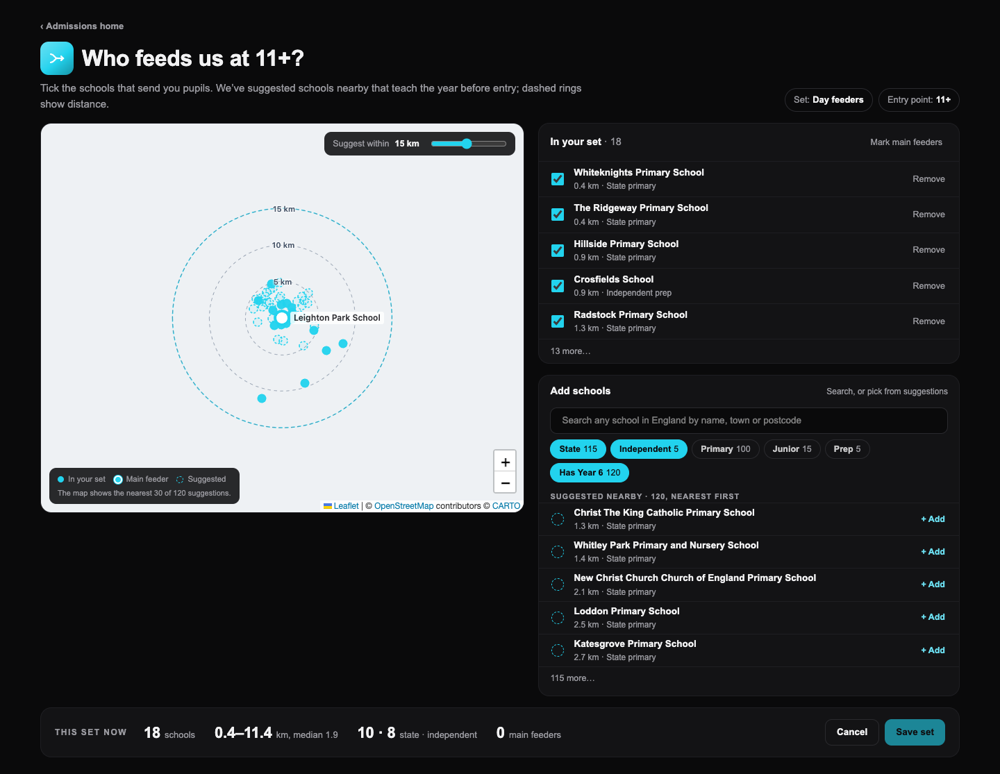
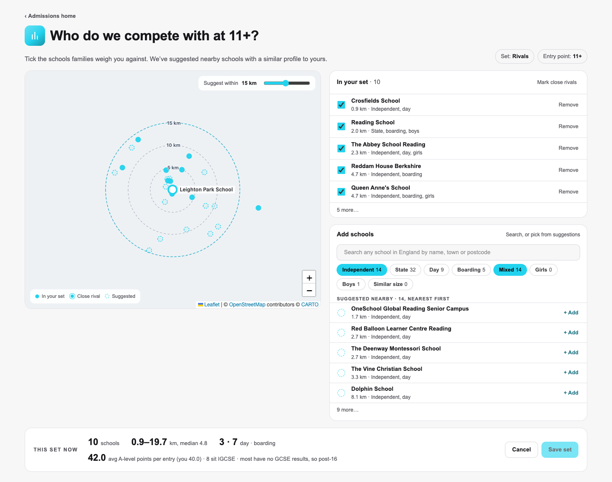
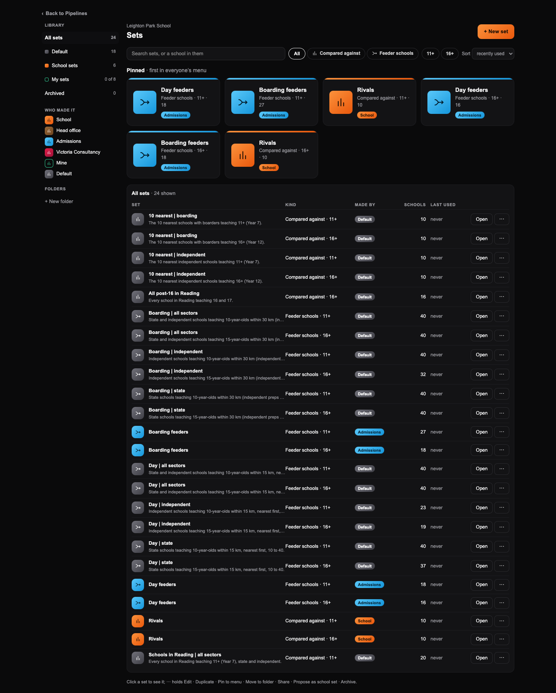
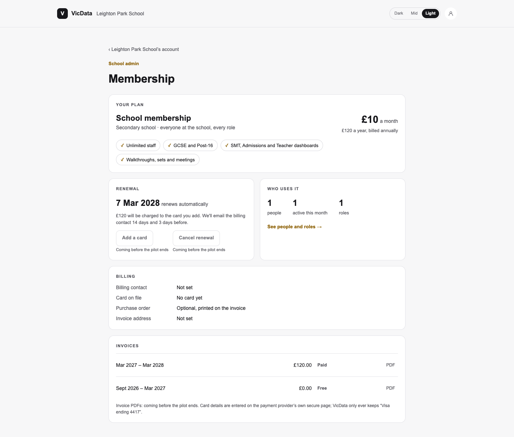
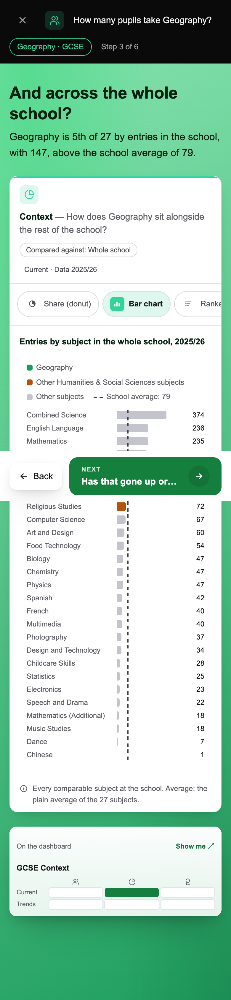

# VicData 0.8 front door, part 2: guided sets, school admin and phone — report

Built straight through, unattended, from `docs/v0.8/vicdata_0_8_front_door_part2_sets_admin_phone_claude_code_prompt_v1.md`, on branch **`v0.8-front-door-2`** (from `main` 32c737e, which holds Part 1 and group sets: checked before starting). Local, not pushed or merged. **Nothing was written to any database.** The one migration is written and tested in PGlite and **not applied**: Guy's step 1 applies it. Every call made along the way is in `docs/OPEN_QUESTIONS.md` under "2026-11-13: front door, part 2" (M1 to M3).

## How far it got

| Milestone | What | Commit |
|---|---|---|
| 1. Guided sets (D21-D23), FD5 | the guided editor (`/sets/guided`) for feeders, rivals and SMT comparison sets; the homes' sets card opens it; the library's maker colours; the Group pages' leftover orange to bronze | `1b2f11c` |
| 2. School admin (F26, F28-F29) | the account page and the menu's badge; the membership record (migration), its pilot seed and the membership page | `027c966` |
| 3. Phone layouts (G) | Part 1's welcome, setup, homes and walks, and this part's screens, at phone width | `1836e8d` |
| 4. The report | this file, the screenshots, the measurements, parity | (this commit) |

All four milestones are done. **What is left, or thinner than the prompt drew it** (each is in OPEN_QUESTIONS):

- **The guided editor, the account page and membership weren't used in a browser signed in** (the local app is behind the gate): they were drawn and measured by the harness with real data, and their saving and reading are covered by the unit tests, the rule runners (live, read-only) and PGlite. Saving a set through the guided editor is on Guy's live check (step 7).
- **The set menus' Edit still opens the round-1 editor**, as asked (recommendation below).
- **"Similar size" can't help an independent school:** the census has no age-by-age rolls for independent schools, so the chip reads 0 there (it works for state schools) and isn't pre-selected without a roll.
- **The shell's nav** (account button, Dark · Mid · Light switch) stays under 44 px at phone width: it is every dashboard's nav, so changing it would move every dashboard's phone picture. Left for a shell round.
- **Parity was run once, at M3** (`1836e8d`), on every harness, against `main` (see Tests and parity); each milestone was checked by tsc, eslint, build, every unit, rule and PGlite suite and the shared sets SSR parity.

## Guided sets (D21-D23)

**The guided editor**, `/sets/guided` (one screen, Dark and Light; Mid draws Dark):

- **The question is the title:** "Who feeds us at 11+?", "Who do we compete with at 11+?", SMT's "Who do we measure ourselves against?", one line under it, and the set's name and the entry point (SMT: the phase) as chips, each a menu (the school's sets of that kind for the page and "+ New set"; the school's entry points or GCSE / Post-16).
- **The map** is the shared Leaflet map (`ConsortiumMap`, three additive props: distance rings, dashed markers, permanent labels), centred on the school with 5, 10 and 15 km rings: set members solid, main feeders / close rivals larger and labelled, suggestions dashed; hovering a suggestion says "+ name, click to add" and a click adds it. "Suggest within N km" (2 to 30, starting at 15) is a ring in the accent. The map draws the nearest 30 suggestions (the list holds them all).
- **Right column:** "In your set" (tick, Remove, the Main / Close tag, "Mark main feeders" / "Mark close rivals"), then "Add schools" (first for a new, empty set): the search for any school in England (`SchoolSearch`), the filter chips with counts, the suggestions nearest first with "+ Add". Feeders: State · Independent · Primary · Junior · Prep · Has Year 6 (at 11+). Rivals and SMT: Independent · State · Day · Boarding · Mixed · Girls · Boys · Similar size. Pre-filtered to the school's profile; one tap undoes a chip; the map follows them.
- **This set now**, live: schools; the distance range and median; state · independent (feeders) or day · boarding (rivals); main feeders, or the rivals' average Attainment 8 against yours with the count that sit IGCSE, on the measure the shared IGCSE rule picks (`IGCSE_SWITCH_SHARE`, 40%): Leighton Park's rivals switch to post-16 ("42.0 avg A-level points per entry (you 40.0) · 8 sit IGCSE · most have no GCSE results, so post-16"). Cancel / Save set.
- **Same model and permissions as round 1.** Rows and suggestions come from the round-1 editor route (one switch, `wide=1`, and five extra fields the round-1 editor ignores); saving is `store.ts saveSet` (`save_set`); a curator saves the school set, anyone else a copy as their own (`canCurate`, `creatorFor`, `saveModeOf`); Main / Close is the round-1 `main` tier. No second engine.
- **The homes' card:** Admissions "18 feeders · 10 rivals at 11+ — Who feeds us, and who do we compete with?" with a button for each question (following the home's entry point); SMT "n comparison sets — Who do we measure ourselves against?". "All sets" keeps the round-1 library one tap away. From the home, Back reads "‹ Admissions home" / "‹ SMT home".

**Should the set menus' Edit open the guided editor?** My recommendation: **not yet.** The menus are on the dashboards, used by people already comfortable with the round-1 editor, which does things the guided one doesn't (rename, describe, Save as, Share, Archive, feeder tiers beyond Main, grouping a big feeder set). Keep Edit on the round-1 editor and see how pilots use the guided one from the homes; if they never need the round-1 extras, make the guided editor the default for school feeder and rival sets and keep "Advanced…" for the rest. It's a one-line change (the menus build their Edit address in one place each).

**The sets library's colour (D23)**, on the plain page: every set has a solid gradient icon tile in its maker's colour with the kind's icon; pinned sets are larger tiles with a top strip; "Made by" is a solid gradient pill; the sidebar has coloured markers and a "Who made it" key; the kind filters carry their icons and "+ New set" is the one solid button. Makers: Default graphite; School (a curated compared-against set, whoever curated it) orange; Head office bronze; Admissions (a curated feeder set) sky; Victoria Consultancy rose; Mine an outline in the person's phase colour. The set menus keep round 1's tinted creator pills (so no dashboard picture moves).

**FD5, the Group pages' leftover orange:** every orange text and chip colour on the Group pages is now head office bronze, in one constant (`GROUP_BRONZE`), Light and Dark (Dark's accent text, chips and strong text were orange too). Every one of the 168 Group-page parity pictures moves, by colour only (the swaps are listed under Parity), and the Light pictures of SMT seen as head office move by the banner's link; words are identical in all of them.

## School admin (F26, F28-F29)

- **The account page**, `/teacher/school-account`, from the account menu's new "School account" row (School-Admins and account holders): Join requests, People and roles, Teams, School sets, Head office sharing (only when the school has a group with a VicData account; it opens the school's own group card, as the SMT home draws it), Membership. Each row has a one-line summary from real data and a badge when something waits: "3 new" join requests, "Add a card" from month 4 of a pilot without one. Sign-ins and devices is Part 3's: no row.
- **The account menu's badge** is the page's own waiting count, from the same route, shown exactly when it is more than 0 and only to a School-Admin or account holder.
- **The membership page**, `/teacher/school-account/membership`, from the record alone: a pilot ("Pilot · free for 6 months, until 7 Mar 2027", the price it will be; from month 4 without a card, "Add a card to keep VicData after 7 Mar 2027"), an active school (plan, £10 a month / £120 a year, renewal date, "renews automatically", what it will charge, the reminder emails 14 and 3 days before), a primary school (£5 / £60), a school covered by its group ("Covered by [group]": no billing, the group's billing contact) and a lapsed one; Who uses it (people, active this month, roles); Billing (contact, card summary only, optional purchase order, invoice address); Invoices. **No payments:** Add a card / Update card, Cancel renewal and invoice PDFs are visible and disabled, "Coming before the pilot ends".

### The new tables and RLS

One migration, `supabase/migrations/20261124090000_v08_front_door_r2_membership.sql` (named after the latest on `main` and in the live history, both `20261123090000`, checked read-only on 13 Nov):

| Table / function | What | Who reads | Who writes |
|---|---|---|---|
| `membership_plans` | code, name, applies to (secondary / primary / group), price a month and a year in pence, a group's per-school price, billing (annual), pilot months (6). Seeded: secondary 1000 / 12000, primary 500 / 6000, group null / null and 1000 a school | every signed-in member | platform admins |
| `membership_volume_bands` | a plan's per-school price from a number of schools (the bulk discounts: modelled, no rows) | every signed-in member | platform admins |
| `account_memberships` | one per school account or group account: plan, status (pilot, active, covered_by_group, lapsed), joined, pilot end, renewal, auto-renew, the covering group, billing contact, purchase order, invoice address, card brand / last four / expiry (nullable). **No card number column**; last four is checked to be four digits | the school's School-Admin and account holder; a group's head-office admins (its own record); platform admins (`can_read_membership`) | platform admins |
| `membership_invoices` | a record's period, amount, status (free, due, paid, void), the PDF's future path | as its record | platform admins |

Anon reads nothing. **The pilot seed**, `supabase/seeds/membership_pilots.sql` (run after the migration): every school account a pilot from `school_accounts.created_at`, six months free, on Primary when the school's oldest pupils are 11 or younger, else School membership; non-preview group accounts as group pilots. Re-runnable; a school with a record keeps it. Guy sets the real dates afterwards. **PGlite** (`supabase/tests/v08_front_door_r2_membership_pglite.mjs`, **29 / 29**): the plans and prices; the school's admin and holder read their record and invoices, a teacher, a pending admin, another school's admin, head office and anon don't; head office reads the group's own; only platform admins write; no card number column and a card summary is four digits; one holder, a pilot's end date, covered names the group; the seed's pilots, dates and plans, re-run, preview groups left out; RLS on all four; the migration twice.

Before the migration is applied the page says "Membership isn't set up on VicData yet" and the account row "Not set up yet": nothing breaks.

## Phone (G)

Every surface of Parts 1 and 2 has a designed phone layout from the same components (breakpoint classes, or the page's phone flag for the guided editor and the School-Admin's pages):

- **Welcome and setup:** one column; the subject list as full-width 44 px rows (name left, entries right).
- **Homes:** one tile per row; the walk's icon row wraps under the question; the arrow (44 px) on the right; every picker, link and switch 44 px.
- **Walks:** question and answer, then the chart full width; the rail a horizontal scroll of named chips above it; the mini-map under it; Back/Next in a sticky bottom bar. Every walk screen (Teacher's and the role walks) uses one layout, `WalkScreen`; desktop is drawn as before.
- **Guided editor:** the map a 220 px strip with "Expand map"; "In your set" and "Add schools" two tabs; "This set now" and Save in a sticky bottom bar.
- **Admin account and membership:** one column of cards.

**Measured at 390 × 844** (headless Chromium, the real components with Leighton Park's and The Chase's data): **36 phone pictures, none scrolls sideways** (scrollWidth 390 on every one), and **every control on the surfaces is at least 44 px**, except Leaflet's attribution links on the guided editor's map (the map's credits: "Leaflet", "OpenStreetMap", "CARTO", 14 px text). The shell's nav was measured outside the surfaces (the homes' and walks' roots are their sections; the admin pages' their column). Leaflet's zoom buttons are 44 px on a phone. The per-picture numbers are in `docs/v0.8/front_door_2_screenshots/mobile_390_measure.json`. The source scanner behind R-FRONT-DOOR-MOBILE checks the same 12 files on every rule run.

## Screenshots

`docs/v0.8/front_door_2_screenshots/` (1440 wide; phone at 390 × 844, captured at 2×). Drawn by a harness from the app's own components and the built CSS, with **real data** captured read-only through the app's own route handlers (Leighton Park 110110 for the sets, homes, setup and account; The Chase 137625, GCSE Geography, for the walks). Phone pictures are full-page captures, so a sticky bottom bar shows where the 844 px viewport ended, mid-picture. Two harness limits: the CARTO basemap needs the production API key, so the maps draw their rings and dots on a plain background; and no live membership record exists yet, so the membership pictures read a record built from Leighton Park's real join date (7 Sep 2026: pilot to 7 Mar 2027; the active picture is that pilot followed by a year), with no card or billing contact. The month-4 picture sets the date to 10 Dec 2026 to show "Add a card" and the menu's badge.

| Screen | Files |
|---|---|
| Guided editor, feeders (Leighton Park, 11+, its 18 day feeders) | `guided_feeders_{dark,light,mid}_1440.png` (Mid draws Dark), `guided_feeders_{dark,light}_390.png` |
| Guided editor, rivals (its 10 rivals; post-16 points, 8 IGCSE) | `guided_rivals_{dark,light,mid}_1440.png`, `guided_rivals_{dark,light}_390.png` |
| Sets library (24 sets: 18 default, 6 school) | `library_{dark,light,mid}_1440.png`, `library_{dark,light}_390.png` |
| School-Admin account page | `admin_account_{dark,light,mid}_1440.png`, `admin_account_{dark,light}_390.png` |
| Membership, pilot | `membership_pilot_{dark,light}_1440.png`, `membership_pilot_{dark,light}_390.png`; month 4 ("Add a card", the menu's badge): `membership_pilot_month4_dark_390.png` |
| Membership, active | `membership_active_{dark,light}_1440.png`, `membership_active_{dark,light}_390.png` |
| Welcome, phone | `welcome_{mid,dark,light}_390.png` |
| Setup, phone (GCSE and Post-16 subjects as rows) | `setup_{mid,dark,light}_390.png` |
| Teacher home, phone (both phases) | `home_teacher_{mid,dark,light}_390.png` |
| SMT home, phone | `home_smt_{mid,dark,light}_390.png` |
| Admissions home, phone (the new sets card) | `home_admissions_{mid,dark,light}_390.png` |
| GCSE walks, phone (The Chase, Geography): How many (screens 1 and 4), How well (2), How do we compare (1) | `walk_many_1_{mid,dark}_390.png`, `walk_many_4_{mid,dark}_390.png`, `walk_well_2_{mid,dark}_390.png`, `walk_nearby_1_{mid,dark}_390.png` |

Not drawn: the head office home and a primary school's SMT home on a phone (in the harness they'd need the group fixtures and a primary school's routes; both are built from the same `HomeSection` and tiles, which the scanner checks). The harness is committed as `docs/v0.8/audit_scripts/front_door_2_preview/` (files end .txt).











## Rules

**Added (5):** R-GUIDED-SETS, R-SETS-MAKER-COLOURS (M1); R-MEMBERSHIP, R-ADMIN-BADGE (M2); R-FRONT-DOOR-MOBILE (M3). Each has a runner in `scripts/catalogue-rule-tests.ts` (unit tests named for the rule, run in their own process; R-GUIDED-SETS also checks This set now on Leighton Park's real 11+ rivals; R-MEMBERSHIP runs the PGlite suite; R-ADMIN-BADGE reads Leighton Park's real rows).

**Extended (2):** R-THEME-CONTRAST (the library's maker pairs, the Group pages' bronze pairs, the School-Admin's amber: 97 pairs, all pass); R-THEME-MID-SCOPE (names the guided editor and the School-Admin's pages; its runner checks their roots draw Dark under Mid).

**Retired / rewritten for the maker colours:** none. No rule, runner or unit test named round 1's SMT violet or head office orange maker colours (checked).

`docs/catalogue/*.md` regenerated.

### The contrast table's new rows

| Pair | Colours | Kind | Ratio |
|---|---|---|---|
| Sets library Default: pill text on the light stop | #ffffff on #71717a | small | 4.83 |
| Sets library Default: pill text on the dark stop | #ffffff on #3f3f46 | small | 10.44 |
| Sets library School: pill text on the light stop | #1f0f04 on #fb923c | small | 8.22 |
| Sets library School: pill text on the dark stop | #1f0f04 on #ea580c | small | 5.23 |
| Sets library Head office: pill text on the light stop | #ffffff on #9c6a3a | small | 4.63 |
| Sets library Head office: pill text on the dark stop | #ffffff on #6b431e | small | 8.58 |
| Sets library Admissions: pill text on the light stop | #04202f on #5ac8fa | small | 8.84 |
| Sets library Admissions: pill text on the dark stop | #04202f on #1596db | small | 5.12 |
| Sets library Victoria Consultancy: pill text on the light stop | #ffffff on #e11d48 | small | 4.70 |
| Sets library Victoria Consultancy: pill text on the dark stop | #ffffff on #9f1239 | small | 8.02 |
| Sets library Mine (GCSE): outline text on the Light panel | #12713a on #ffffff | small | 6.09 |
| Sets library Mine (Post-16): outline text on the Light panel | #5b3dd1 on #ffffff | small | 6.92 |
| Sets library Mine (GCSE): outline text on the Dark panel | #34d399 on #141417 | small | 9.56 |
| Sets library Mine (Post-16): outline text on the Dark panel | #a78bfa on #141417 | small | 6.76 |
| Group pages Light: accent text on the panel #ffffff | #7e4f24 on #ffffff | small | 6.93 |
| Group pages Light: strong text on the panel #ffffff | #6b431e on #ffffff | small | 8.58 |
| Group pages Light: accent text on the chip | #7e4f24 on #f7eee4 | small | 6.04 |
| Group pages Light: chip text on the chip | #6b431e on #f7eee4 | small | 7.48 |
| Group pages Dark: accent text on the panel #0b0b0d | #c99a66 on #0b0b0d | small | 7.77 |
| Group pages Dark: strong text on the panel #0b0b0d | #e3bf98 on #0b0b0d | small | 11.40 |
| Group pages Dark: accent text on the panel #141417 | #c99a66 on #141417 | small | 7.26 |
| Group pages Dark: strong text on the panel #141417 | #e3bf98 on #141417 | small | 10.66 |
| Group pages Dark: the accent (GROUP_ACCENT) as text on the panel #0b0b0d | #a8743f on #0b0b0d | small | 4.90 |
| Group pages Dark: the accent (GROUP_ACCENT) as text on the panel #141417 | #a8743f on #141417 | small | 4.58 |
| Group pages Dark: accent text on the chip | #c99a66 on #21170e | small | 6.95 |
| Group pages Dark: chip text on the chip | #e3bf98 on #21170e | small | 10.20 |
| School admin Light: role text and links on the panel | #8a5d00 on #ffffff | small | 5.76 |
| School admin Light: the row icon on its tint | #8a5d00 on #fdf3dc | mark | 5.22 |
| School admin Dark: role text and links on the panel | #fbbf24 on #141417 | small | 11.01 |
| School admin Dark: role text on the page | #fbbf24 on #08080a | small | 11.99 |
| School admin Dark: the row icon on its tint | #fbbf24 on #2a2412 | mark | 9.25 |
| School admin: the badge's text on its amber (both themes) | #1f1300 on #fbbf24 | small | 10.93 |

All 97 pairs of the table pass (65 from Part 1, 32 new).

## Tests and parity

Every check was run at each milestone (M1 `1b2f11c`, M2 `027c966`, M3 `1836e8d`); the numbers below are M3's. Every suite run as its header says; unit files one per process (`--test-force-exit`; group files with the fixture switch on).

| Check | M1 | M2 | M3 |
|---|---|---|---|
| tsc | clean | clean | clean |
| eslint | 0 errors (2 warnings, both older than this branch) | same | same |
| build (`next build`) | passes | passes | passes |
| Unit, every `src/**/*.test.ts(x)` | 88 files, 685 pass, 0 fail | 89 files, 692 pass, 0 fail | **90 files, 699 pass, 0 fail** |
| PGlite, RLS and usage log, every suite | 28 / 28 suites pass | 29 / 29 (`v08_front_door_r2_membership` 29 / 29) | **29 / 29** |
| Rule tests, the full suite (production reads) | 178 pass, 0 fail | 180 pass, 0 fail | **181 pass, 0 fail, 0 error** (15 manual, 19 no test, 8 superseded) |
| Shared sets SSR parity (SetSelector in 24 states, the creator pills, every way-back rule), against `main` 32c737e | byte-identical | byte-identical | byte-identical |

M1's one unit failure on the first run was the featured-row scan asking for the guided editor's school lists to be registered (they have no focus row: the school is the map's centre); fixed before the commit. Nothing failed on `main` that this branch leaves failing: Part 1's known failures (`editor-guarantees`, `v08_view_as_editing` 42 / 44) pass on `main` 32c737e now.

### Parity

Base `main` 32c737e against the branch at M3 (`1836e8d`), each in its own detached worktree, run by a child session with the previous round's harnesses (Playwright's headless Chromium 131). Each harness captured its fixtures from each tree's own code: **byte-identical between the trees in every harness** (Teacher 10 / 10, Admissions 4 / 4 schools, SMT 2 / 2, Groups Harris and Dukes). As in Part 1, every pair was compared as PNG, DOM and **words** (every figure, label and title); a pair is allowed when its words are identical.

| Harness | Pairs | Identical | Pixel-only (words identical) | Words differ | Not compared |
|---|---|---|---|---|---|
| Teacher walker, all 7 case sets | 2,698 | 2,680 | 18: the known flakes (17 × the bar chart's first-measurement height, short on main in one run and on the branch in the next; 1 × the pending-rank map in the harness README) | **0** | 6 failed walker cases (3 on each side), left out, never counted as passes |
| Teacher re-check of those 18 cases, twice | 401 + 401 | 393 / 394 | 8 / 7, the same flakes | **0** | — |
| Public school page SSR (137625, 117037) | 2 | 2 (byte-identical) | — | 0 | — |
| Admissions: 4 schools × 2 entry points × both themes × 1440 and 390, every rail step | 468 | **468** (PNG and DOM) | 0 | 0 | — |
| SMT: 2 schools × 4 dashboards and the home × both themes × widths, every rail step | 150 | 142 | 8: Context at 1440, 7 to 39 antialiasing pixels, DOM identical; each tree varies the same way run to run | 0 | — |
| SMT seen as head office (`?headOffice=`) | 142 | 71 (all Dark) | 71 (all Light): the banner's link, #c2410c → #7e4f24 (FD5) | 0 | — |
| Group pages: Harris and Dukes, 4 dashboards, set and subset states, both themes and widths | 168 | 0 | **168: colours only** (FD5) | 0 | — |
| Head office home | 8 | 0 | 8: M3's phone tap-target classes | 0 | — |
| Data View | — | — | — | — | not re-walked: its import graph reaches only `teacher-view-theme.ts`, which gains constants only |

**No figure changed anywhere.** The Admissions and SMT maps are byte-identical (the map's new props are additive), and the closed account menu is unchanged in every Teacher and SMT DOM.

**The parity pictures that moved, and why:** all 168 Group dashboard pictures (Overview, Schools, Academic, Pupils, for Harris and Dukes, both themes, 1440 and 390, every rail step and set state): FD5's orange → bronze, with structure identical once colour values are set aside and every swap one of these:

| Base (orange) | Branch (bronze) | Where |
|---|---|---|
| #c2410c | #7e4f24 | Light accent text |
| #9a3412 | #6b431e | Light strong text and chips |
| #fdba74 | #d9bfa3 | Light chip, card edge and range edge |
| #fff7ed | #f7eee4 | Light chip background |
| rgba(251,146,60,.14) | rgba(168,116,63,.14) | Light tint |
| #fb923c | #c99a66 | Dark accent text |
| #fed7aa | #e3bf98 | Dark strong text and chips |
| #4a2c14 | #4a3420 | Dark chip, card edge and range edge |
| #21150b | #21170e | Dark chip background |
| rgba(251,146,60,.12) | rgba(168,116,63,.12) | Dark tint |

Also the 71 Light pictures of SMT seen as head office (the banner's link) and the 8 head office home pictures (M3's tap targets). The sets library, the guided editor and the School-Admin's pages are new or allowed and aren't in the harnesses (their pictures are above).

## Seams left for Part 3

- **Sign-ins and devices (F27):** no row on the account page; add one to `accountRows` (`src/lib/school-admin/membership.ts`) with its badge ("1 flag") and `waitingCount` picks it up for the menu's badge.
- **Join requests' on-domain / off-domain "exception" badge:** the row counts `pending_approval` memberships today; Part 3's domain rule can mark exceptions on the same row.
- **The beta gate and sign-in screens' phone layouts:** add their files to `FRONT_DOOR_SURFACES` (`src/lib/front-door/mobile-scan.ts`) and R-FRONT-DOOR-MOBILE checks them.
- **Payments:** the membership record has the card summary columns and `membership_invoices.pdf_path`; the disabled buttons say "Coming before the pilot ends" (`PAYMENTS_LATER`).
- **The shell's nav at phone width** (34 px account button, the theme switch): left for a shell round (it moves every dashboard's phone picture).

## Guy's commands

The branch `v0.8-front-door-2` is local, not pushed: the worktree at `~/.t3/worktrees/vicdata_public/t3-5896de89` shares the repository with `~/dev/vicdata_public`, so it is there already. The live site is **`https://vicdata.co.uk`**.

**1. Migrations** — apply the membership migration and record it (writes: the project-ref check first), check it, then seed the pilots.

```
cd ~/dev/vicdata_public && test "$(cat supabase/.temp/project-ref)" = "lnhulykjlxmoneappnsp" && git show v0.8-front-door-2:supabase/migrations/20261124090000_v08_front_door_r2_membership.sql > /tmp/front_door_r2.sql && supabase db query --remote --yes -f /tmp/front_door_r2.sql && supabase db query --remote --yes "insert into supabase_migrations.schema_migrations (version, name) values ('20261124090000', 'v08_front_door_r2_membership') on conflict (version) do nothing" && supabase db query --remote --read-only "select version, name from supabase_migrations.schema_migrations where version = '20261124090000'"
```

Expect one row: `20261124090000 | v08_front_door_r2_membership`. Check the tables, RLS and the plans:

```
cd ~/dev/vicdata_public && supabase db query --remote --read-only "select relname, relrowsecurity from pg_class where relname in ('membership_plans', 'membership_volume_bands', 'account_memberships', 'membership_invoices') order by relname" && supabase db query --remote --read-only "select code, price_month_pence, price_year_pence, per_school_month_pence from membership_plans order by code"
```

Expect four rows, all `true`; then group null / null / 1000, primary 500 / 6000, secondary 1000 / 12000. Then the pilots (every school account, from its join date):

```
cd ~/dev/vicdata_public && test "$(cat supabase/.temp/project-ref)" = "lnhulykjlxmoneappnsp" && git show v0.8-front-door-2:supabase/seeds/membership_pilots.sql > /tmp/membership_pilots.sql && supabase db query --remote --yes -f /tmp/membership_pilots.sql && supabase db query --remote --read-only "select status, plan_code, count(*) from account_memberships group by 1, 2 order by 1, 2"
```

Then set the real pilot dates by hand where they differ (`update account_memberships set pilot_ends_on = …, renews_on = … where school_account_id = …`).

**2. Merge and push** — from `~/dev/vicdata_public` on a clean `main`, merge, build, push (the branch already holds `main` 32c737e, so nothing to resolve unless `main` has moved since):

```
cd ~/dev/vicdata_public && git checkout main && git pull https://github.com/guyVicData/vicdata_public.git main && git merge --no-ff v0.8-front-door-2 -m "0.8 front door part 2: the guided sets editor and the library's maker colours; the Group pages in bronze; the School-Admin's account page, badge and membership page; phone layouts for every front-door screen" && npm run build && git push https://github.com/guyVicData/vicdata_public.git main
```

**3. Render deploys main on its own** (auto-deploy, On Commit). If no deploy starts within 5 minutes, deploy by hand.

**4. Wait until /api/version shows the merge commit.**

```
cd ~/dev/vicdata_public && M=$(git rev-parse --short=12 HEAD) && until curl -s https://vicdata.co.uk/api/version | grep -q "\"commit\":\"$M\""; do echo "waiting for $M"; sleep 30; done && curl -s https://vicdata.co.uk/api/version
```

**5. Republish:** none this round. No published dashboard changed (`src/catalogue/dashboards` is untouched).

**6. Set fixed:** none this round (no feedback items).

**7. Live check** — on vicdata.co.uk, in Dark and Light (and Mid on the homes and walks):

- **An Admissions lead** (Leighton Park, a lead login; View as is read-only, so saving needs a real login): home → the sets card reads "18 feeders · 10 rivals at 11+" → **Who feeds us?** → the guided editor: "Who feeds us at 11+?", the map with the rings and the basemap, your 18 feeders solid. Tap **Has Year 6** off and on (the counts and map follow), widen **Suggest within**, hover a dashed school ("+ name") and click it; **Mark main feeders** and mark two; This set now reads the new count and "2 main feeders" → **Save set** → back on the home, the card's count has moved; Pipelines shows the two Main feeders first. Then **Who do we compete with?**: the chips start on Independent and Mixed; This set now reads the rivals' post-16 points and the IGCSE count.
- **An SMT member:** home → the card "n comparison sets — Who do we measure ourselves against?" → **Choose our comparison schools** → "Who do we measure ourselves against?" with Phase: GCSE; add a school by the search, save; the SMT dashboards' Compared against menu lists the set.
- **A School-Admin:** the account menu shows **School account** (with a badge when someone is waiting to join) → the account page: Join requests, People and roles, Teams, School sets, Membership (and Head office sharing at a school in a group) → **Membership**: "Pilot · free for 6 months, until [your date]", £10 a month (£120 a year), the disabled Add a card / Cancel renewal saying "Coming before the pilot ends". A read-only peek: `/teacher/school-account?lookAs=110110&as=school_admin&peek=1`.
- **A teacher on a phone** (or the browser at 390 px): the home's tiles one per row, the arrow on the right → a GCSE walk: question and answer, the chart full width with the rail as chips above it, the mini-map under it, Back / Next fixed at the bottom; no sideways scrolling anywhere.
- **The sets library** (`/sets`): coloured tiles and pills (Admissions sky, School orange, Default graphite), the Who made it key.
- **The Group pages in Light:** bronze text and chips, no orange.
