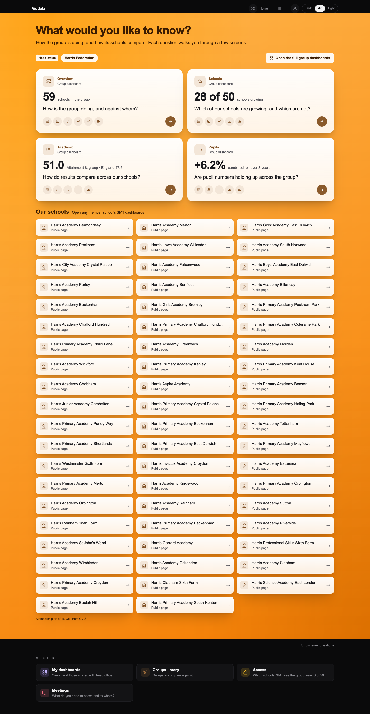
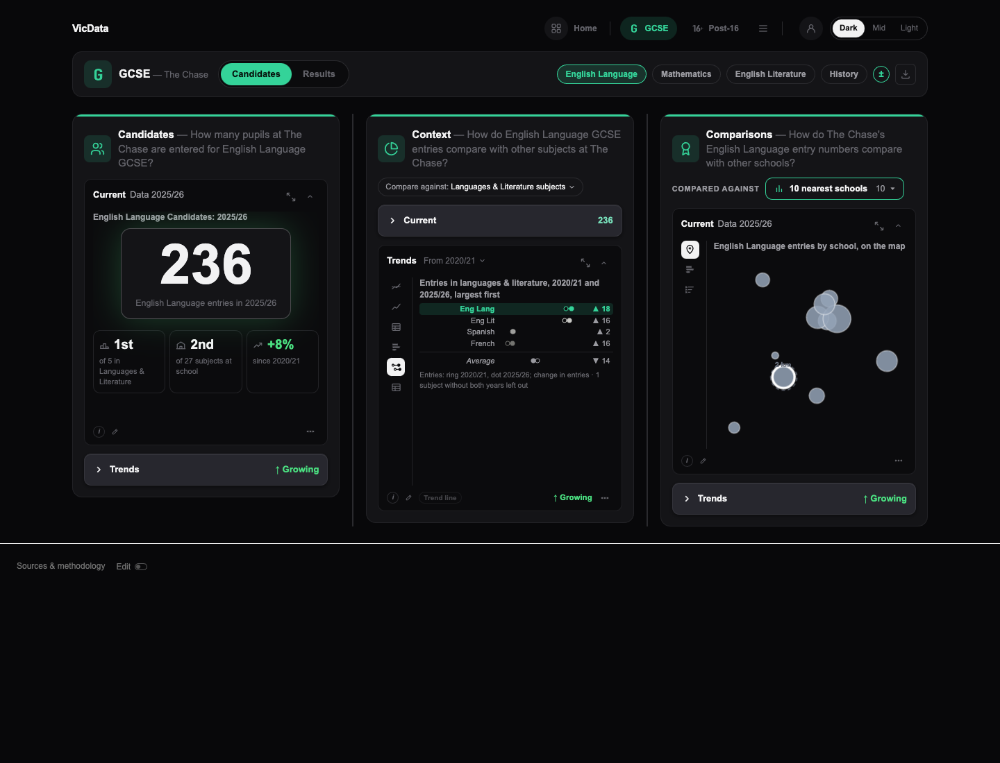
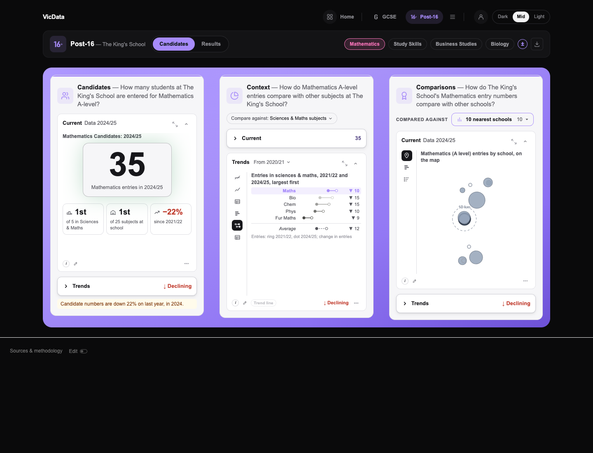
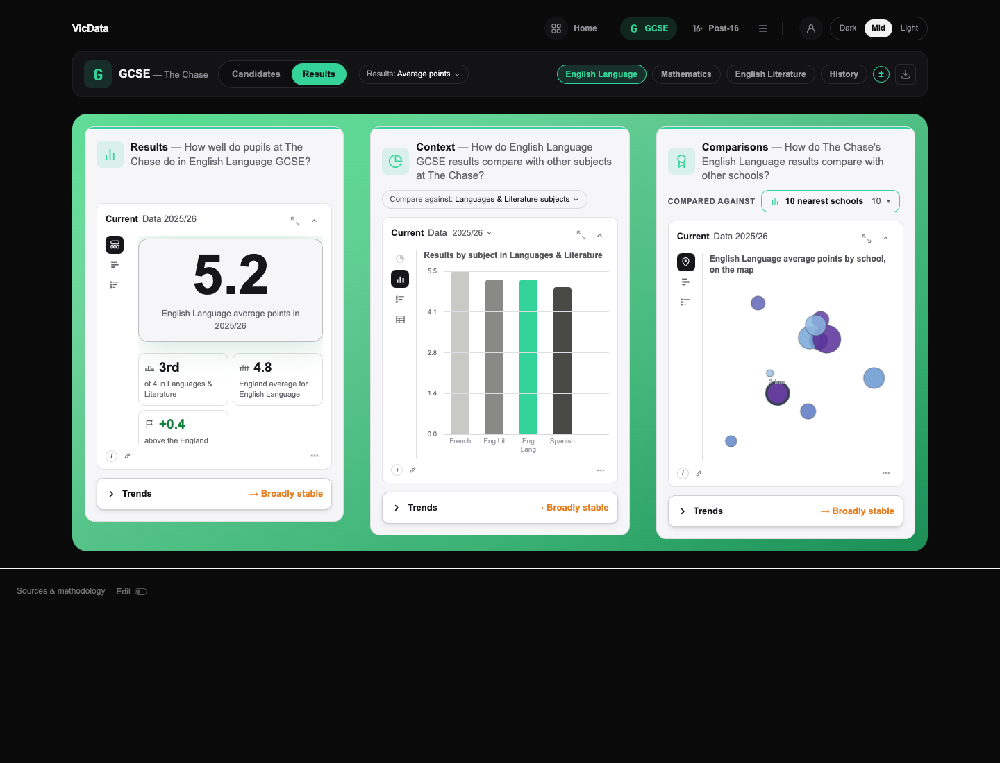
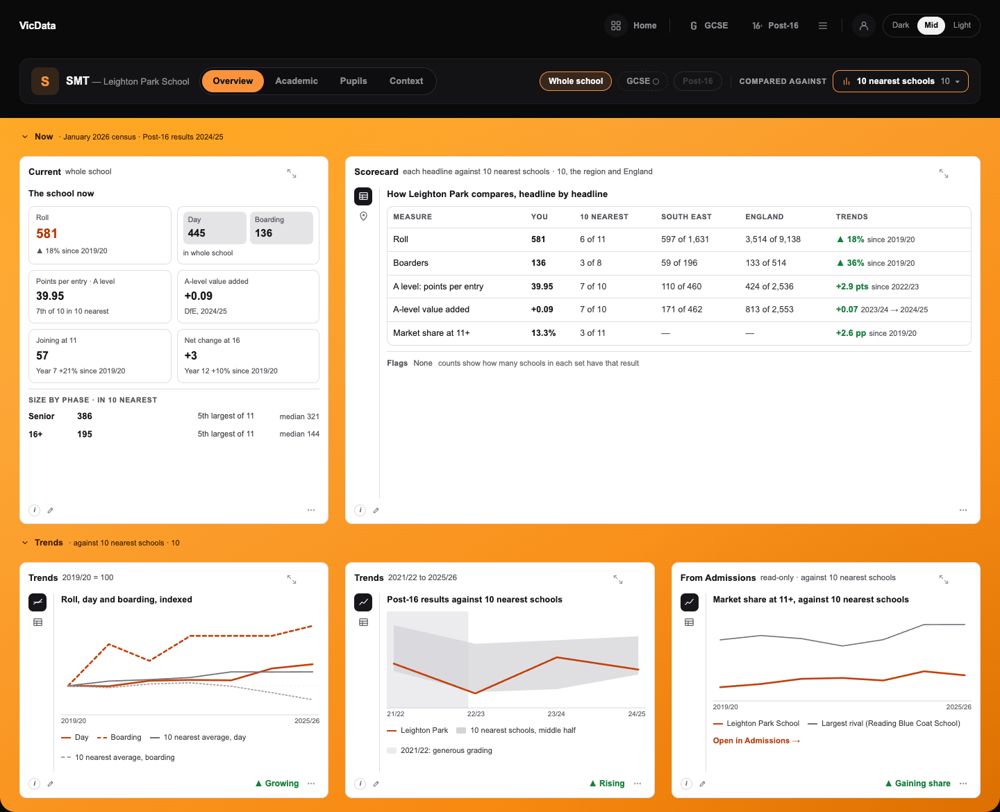
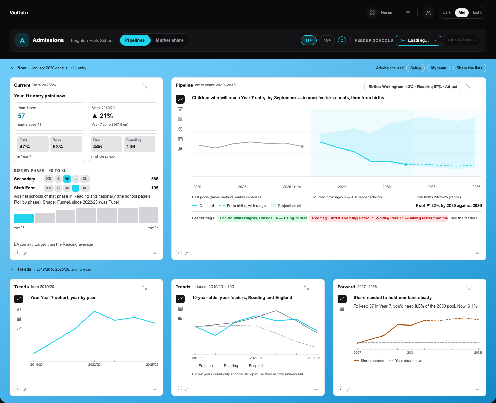
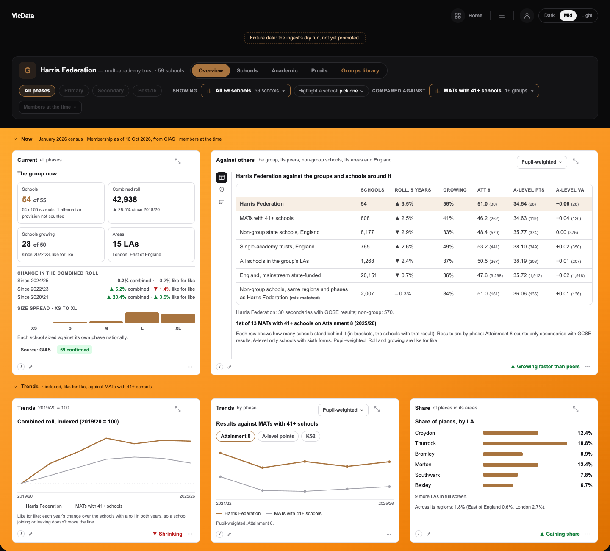
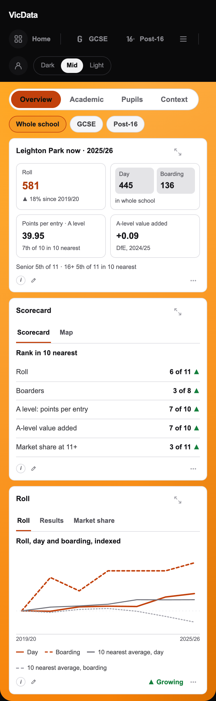
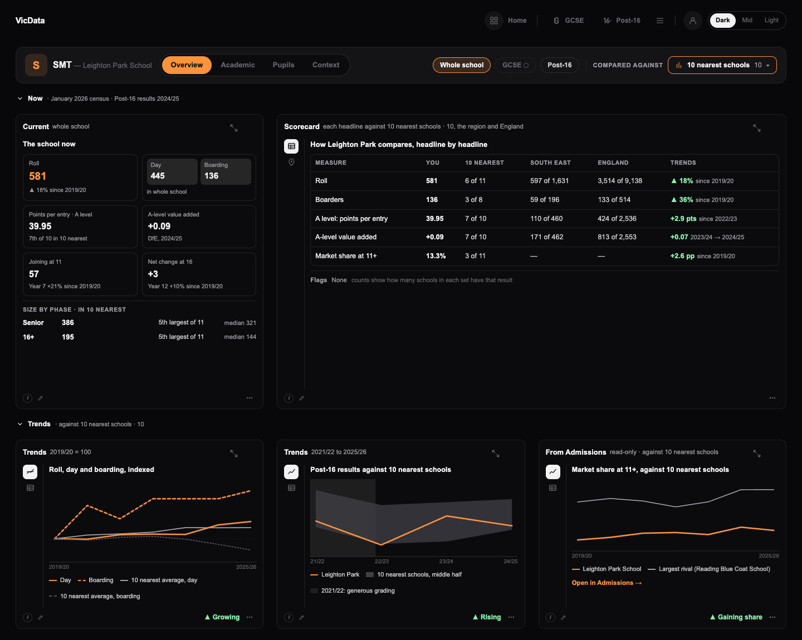

# VicData 0.8 front door, 2b: the two missing tile figures, the dumbbell on the Trends rail, Mid on the dashboards — report

Built straight through, unattended, from `docs/v0.8/vicdata_0_8_front_door_2b_claude_code_prompt_v1.md`, on branch **`v0.8-front-door-2b`** (from `main` ed8828d, which holds front door Parts 1 and 2 and group sets). Local, not pushed or merged. **Nothing was written to any database** and **no migration** was needed. Every call made along the way is in `docs/OPEN_QUESTIONS.md` under "2026-11-13: front door, 2b" (M1 to M3).

## How far it got

| Milestone | What | Commit |
|---|---|---|
| M1. The two tiles without a figure | SMT Context ("▼ 0.5% children nearby, next 5 years") and head office Academic ("51.0 Attainment 8, group · England 47.6"), fetched after the home draws through their walk's own read, cached for the session | `7e10840` |
| M2. The dumbbell on Context › Trends | "Change (dumbbell)" on the GCSE and Post-16 Candidates dashboards, after Ranked change, with its own view kind | `de89bf7` |
| M2 follow-up | the dashboard dumbbell spans the first and latest years a subject holds (found while drawing The King's School); the card's average row reads "Average" | `fd5516e` |
| M3. Mid on the dashboards | every dashboard follows Mid: the header a dark band, the area worked in its part's coloured field, Light's plates and ladder on it; Dark and Light unchanged | `3f9deda` |
| The report | this file, the screenshots | (this commit) |

All three milestones are done, each committed with tsc, eslint, build, the unit, rule, catalogue, RLS and usage-log tests, every PGlite suite and every parity harness clean (Tests and parity, below). **What is thinner than the prompt drew it** (each in OPEN_QUESTIONS):

- **The SMT home's Context tile wasn't drawn in a browser here.** The SMT harness's home draws the Teacher sections (its role stub doesn't reach the SMT section), so the tile's figure is proved by the unit and rule tests (it equals the walk's first screen on Leighton Park and The Chase, read live) and the late-load path by the head office home, which runs the same hook and does draw. On Guy's live check (step 7).
- **The KS2 dashboard in Mid wasn't drawn** (the Teacher harness has no KS2 fixture). It runs the Teacher dashboard's own Mid path with the top level's orange, as the Teacher home's KS2 section does. On the live check.

## M1. The two home tiles without a figure

| Tile | Figure (real data) | Its walk's first screen | Route and parameters (both the tile's and the walk's) |
|---|---|---|---|
| **SMT Context** | Leighton Park **▼ 0.5%** children nearby, next 5 years; The Chase **▼ 5.1%** (ages 11–18, 2025 to 2030) | DV-SMT-C-NOW, `ContextNow`'s projection tile, word for word | `/api/smt/context?urn=…&area=around&level=whole` (`smtContextUrl`) |
| **Head office Academic** | Harris **51.0** Attainment 8, group · England 47.6; Dukes **47.7** · England 40.2 | GRP-A-NOW, Results now and its answer sentence | `/api/group/dash?dash=academic&reading=at_time&focus=all&account=…&compare=nearest` (`groupWalkDashUrl`, the walk's default comparison) |

- **One source for both.** `src/lib/front-door/tile-figures.ts` holds the address builders the walks now call too, and the figure functions: SMT's is `ContextNow`'s own formatting of the projection; head office's is the headline the walk's answer reads (`groupAcademicHeadline`, now shared by `group-answers.ts`), "the phase in view" being the first phase with a group figure (focus All phases, so secondary: Attainment 8).
- **Never slows the home.** `useLateTileFigure` (`src/components/front-door/late-figure.ts`) waits for the home's own reads (SMT: the overview; head office: `/api/group/home`), then for the next paint and an idle moment (600 ms at most), then reads through the app's client cache (`fetch-cache.ts`), so the walk's first screen opens from the same answer. The tile shows its question at once with no placeholder; the figure fades in (0.45 s, none with reduced motion); on an error or no data the tile stays as it is.
- **Cached for the session.** `fetch-cache.ts` lives in memory for 5 minutes, so a small session-scoped layer keeps the figure itself (a few words) in `sessionStorage`, keyed by the address, the signed-in person and any peek; no data is cached as "none", an error never.

**Timing** (the head office home in headless Chromium, Harris, the branch's own code; ms from navigation):

| | the home drawn (its tiles) | the Academic read starts | lands | the figure in |
|---|---|---|---|---|
| First visit, run 1 | 205–207 | 222 | 223 | 224 |
| First visit, run 2 | 209–211 | 218 | 218 | 219 |
| Reload in the same tab | 132–133 | — (no read) | — | 134, from the session cache |

The home always draws first; the read starts after it (the harness answers routes at once, so the gap live is the route's own time, which the home no longer waits for).



**R-HOME-TILES (extended):** its statement names the two figures and how they load; its runner adds `tile-figures.test.tsx` (the SMT tile against `ContextNow` on Leighton Park and The Chase, live, both env files; one address for tile and walk; no placeholder; the cache key keeps people and peeks apart) and the R-HOME-TILES tests in `group-walks.test.tsx` (the Academic tile against Results now and its answer, Harris and Dukes on the fixtures). **PASS** (5 of 5 SMT, 2 of 2 head office).

## M2. The dumbbell on Context › Trends

"Change (dumbbell)" (`DV-C2-TR-DUMBBELL`) is on the **GCSE Candidates and Post-16 Candidates** dashboards' Context › Trends rail: Indexed, Actual, Trend table, Ranked change, **Change (dumbbell)**, Change table, with its rail icon. Not on Results (it draws entries).

- **Its own view kind.** The config renderer draws every view from its ViewSpec, and Part 1's preset was Ranked change's bars as a stand-in, so the preset is now `{ kind: "dumbbell" }`, a kind with no builder: the renderer hands it to Context's host (SubjectPanels), as the Admissions kinds work. The editor knows the kind (label, icon, an honesty line) but doesn't offer it as a free choice.
- **The dashboard's own pills and compare:** the subjects the Compared against pill holds, from the first to the latest year any of them holds within the From menu's span (the same first year as Ranked change), in the panel's own colours (the focus in the accent), the comparison group's per-subject average as the dashed row last. Change in entries, ▲ / ▼ only. Dashboard size from `dumbbell.png`: short names, 15 px rows, the focus centred when the list scrolls; full names in full screen. Rows and sentence in `src/lib/teacher-dumbbell.ts`, drawn by `src/components/teacher/DumbbellView.tsx`.





**R-DUMBBELL (extended):** its runner also runs `src/lib/teacher-dumbbell.test.tsx` (both Candidates configs list it right after Ranked change, not Results; the rail label maps to it; its kind is dumbbell and the renderer hands it back; ordering, focus, the group's average, a span opening on a group-only year, the view) and checks the dashboard's rows over The Chase's whole school order as the walk's: **PASS**. The preset doc is regenerated (`scripts/views-preset-table.ts --write`) and its hand-kept follows-page row rewritten; the method note covers the dashboard.

### The republish dry run (Guy's step 5)

`npx -y tsx scripts/dashboards-seed-sql.ts --force --only vicdata.ks4.candidates,vicdata.ks5.candidates` printed the SQL (72 KB, not run). What changes, per dashboard (the code copies on `main` against the branch's):

| Dashboard | Live now | What the republish changes |
|---|---|---|
| `vicdata.ks4.candidates` | v6, equal to `main`'s code copy | panel `c2.trends`: Indexed, Actual, Trend table, Ranked change, **+ Change (dumbbell)** (instance `vicdata.ks4.candidates.c2.trends/DV-C2-TR-DUMBBELL`, kind dumbbell), Change table; nothing else |
| `vicdata.ks5.candidates` | v2, equal to `main`'s code copy | the same on `vicdata.ks5.candidates.c2.trends` |
| `vicdata.ks4.results`, `vicdata.ks5.results` | v17, v4, equal to the branch | nothing: not republished |

"Live now" was read read-only on 13 Nov (the published config of each against each tree's code copy): live holds no editor changes the republish would overwrite. Instance ids are unchanged, so members' open rows and chosen views carry over; the new view is on the rail but no panel opens on it.

## M3. Mid on the dashboards

Dashboards now follow Mid (`R-THEME-MID-SCOPE`, rewritten). Mid stays a choice in Dark · Mid · Light; Dark stays the default.

- **The look carries over from the homes.** The page and the header (the View as banner, the nav, the control bar, the head office banner) stay dark; the area being worked in is its part's coloured field: GCSE green, Post-16 violet, the top level's orange (SMT, and Teacher KS2), Admissions sky, head office the orange field with its bronze accent (the Group pages, the groups library, a group's library page). On the field everything is drawn as Light draws it: columns and open panels on near-white plates, shut panels as Light's raised bars (border, soft shadow, solid chevron, the lead figure in the accent), charts on white with their fixed reference colours and Light's deeper peer ambers, full screen on a near-white plate.
- **How** (`src/components/shell/MidDash.tsx`): under Mid a dashboard's root draws **Light** and is marked `data-mid-dash="<part>"`; its header is a **MidBand** drawn Dark; its ladder element (DashboardGrid; ShellPage, whose band bleeds to the field's edges) is the field. Nested components that ask for the theme get the theme of the part they're in. No component's colours changed.
- **Dark and Light unchanged:** outside Mid the band is a fragment and the root's Mid attributes are absent; the only change in every theme is the Mid button's tooltip (now "the homes, walkthroughs and dashboards in colour (the header stays dark)").
- **Still Dark under Mid:** the sets and admin pages, and the dashboards' own non-dashboard states (loading, no access, Admissions' setup steps and shared lists).
- **Every dashboard:** Teacher GCSE, Post-16, KS2; SMT Overview, Academic, Pupils, Context; Admissions Pipelines, Market share; the Group pages Overview, Schools, Academic, Pupils, the library; full screen; phone layouts (390: no sideways scroll on any).

### Screenshots

`docs/v0.8/front_door_2b_screenshots/` (1440 wide; phone 390 × 844 at 2×), drawn by the parity harnesses from the app's own components and built CSS with real fixtures (The Chase 137625, The King's School 117037, Leighton Park 110110, Harris 3320, Dukes).

| Product | Mid 1440 | Mid 390 |
|---|---|---|
| Teacher GCSE (The Chase) | `teacher_gcse_mid_1440.png`, full screen `teacher_gcse_fullscreen_mid_1440.png` | `teacher_gcse_mid_390.png` |
| Teacher Post-16 (The King's School) | `teacher_post16_mid_1440.png`, `dumbbell_dashboard_post16_mid_1440.png` | |
| SMT Overview (Leighton Park) | `smt_overview_mid_1440.png`, full screen `smt_overview_fullscreen_mid_1440.png`; Context `smt_context_mid_1440.png` | `smt_overview_mid_390.png` |
| Admissions Pipelines (Leighton Park, 11+) | `admissions_pipelines_mid_1440.png`; Market share `admissions_market_mid_1440.png` | `admissions_pipelines_mid_390.png` |
| Group pages (Harris) | `group_overview_mid_1440.png`, `group_academic_mid_1440.png`, the library `group_library_mid_1440.png` | `group_overview_mid_390.png` |
| Nothing moved: SMT Overview in Dark and Light | `smt_overview_dark_1440.png`, `smt_overview_light_1440.png` (pixel-identical to M2: Parity) | |
| The dumbbell | `dumbbell_dashboard_{dark,light,mid}_1440.png` | |













### The contrast table's new rows (R-THEME-CONTRAST)

Text that sits on a bare field takes its ink: an open row's head and context line (SMT, Admissions, the Group pages), Admissions' role line and buttons beside it, the library's lines. Teacher's field holds only its columns, so nothing small sits on GCSE's or Post-16's colour (logged as large). The plates are Light's ladder rows already in the table.

| Pair | Colours | Kind | Ratio |
|---|---|---|---|
| Mid dashboards GCSE: text on the field, light / dark stop | #07200f on #86e3ae / #1e9e5e | large | 11.13 / 5.00 |
| Mid dashboards Post-16: text on the field, light / dark stop | #1a1240 on #c1b0ff / #7a5bef | large | 9.07 / 3.79 |
| Mid dashboards top level (SMT, KS2): text on the field, light / dark stop | #3a1c02 on #ffb74d / #f57c00 | small | 9.01 / 5.77 |
| Mid dashboards top level: a text button in Light's text, dark stop | #17171b on #f57c00 | small | 6.61 |
| Mid dashboards head office: text on the field, light / dark stop | #3a1c02 on #ffb74d / #f57c00 | small | 9.01 / 5.77 |
| Mid dashboards head office: a text button in Light's text, dark stop | #17171b on #f57c00 | small | 6.61 |
| Mid dashboards Admissions: text on the field, light / dark stop | #062436 on #8bd8fb / #1596db | small | 10.14 / 4.89 |
| Mid dashboards Admissions: a text button in Light's text, dark stop | #17171b on #1596db | small | 5.46 |
| Mid dashboards: the header band's text / muted text | #f2f2f3 / #8a8a90 on #0a0a0b | small | 17.69 / 5.77 |

All **112** pairs of the table pass (97 from Parts 1 and 2, 15 new).

**R-PANEL-LADDER (extended to Mid):** the field draws Light's ladder unchanged (no Mid rule overrides a ladder token): a shut bar's border 1.44:1 from its column (logged step 1.4), and a column (#f6f6f8) 1.43:1 at least from every field's lighter stop (GCSE's the closest; logged step 1.4). **PASS.**

## Rules

| Rule | What changed | Why |
|---|---|---|
| R-HOME-TILES | **extended**: the two figures, how they load, their tests | M1 |
| R-DUMBBELL | **extended**: on the Candidates dashboards' Context › Trends, its own kind, the dashboard's pills and span; its runner and tests | M2 |
| R-THEME-MID-SCOPE | **rewritten**: Mid was the homes and walks only; now every dashboard follows Mid through the Mid plumbing, and the sets and admin pages (and a dashboard's non-dashboard states) render Dark under Mid. Its runner checks every dashboard root has the plumbing (the ShellPage products' control bar in the band) and every sets and admin root has none | Guy, 13 Nov: dashboards follow Mid, confirmed as a build |
| R-THEME-CONTRAST | **extended**: the Mid dashboard pairs (`midDashPairs`) | M3 |
| R-PANEL-LADDER | **extended**: Mid's steps; no Mid rule overrides a ladder token | M3 |

No rule retired. `docs/catalogue/*.md` regenerated at each milestone.

## Tests and parity

Every suite run as its header says (unit files one per process with both env files, group files on the fixtures; PGlite's PostGIS suites with their own PGlite, `v08_view_as_editing` under tsx).

| Check | M1 `7e10840` | M2 `de89bf7` (+ `fd5516e`) | M3 `3f9deda` |
|---|---|---|---|
| tsc | clean | clean | clean |
| eslint | 0 errors (3 warnings, all older) | same | same |
| build (`next build`) | passes | passes | passes |
| Unit, every `src/**/*.test.ts(x)` | 91 files, 706 pass, 0 fail | 92 files, 710 pass, 0 fail | 92 files, 710 pass, 0 fail |
| Catalogue unit | 77 / 77 | 77 / 77 | 77 / 77 |
| PGlite, RLS and usage log (every suite) | 29 / 29 | 29 / 29 | 29 / 29 |
| Rule tests, the full suite (production reads, read-only) | 181 pass, 0 fail | 181 pass, 0 fail | 181 pass, 0 fail (15 manual, 19 no test, 8 superseded) |

(`fd5516e`, the M2 follow-up, ran its unit file and R-DUMBBELL; the M3 runs include it.)

### Parity

Part 2's harnesses (headless Chromium 131, the app's own components and built CSS, fixtures captured from each tree's own code: **byte-identical between the trees at every run**). A pair is compared as PNG pixels, DOM (the harness's own bundle names set aside) and **words**.

**M1 and M2, against `main` ed8828d:**

| Harness | Pairs | Result |
|---|---|---|
| Teacher walker, 7 case sets | M1: 2,503 (2,461 compared in words); M2: 2,739 | M1: **every word identical**; 17 pixel flags, all the known flakes (16 × the bar chart's first-measurement height, 1 × the pending-rank map). M2: 2,630 identical in words; **all 109 that differ are Context › Trends on a Candidates dashboard gaining "Change (dumbbell)" on its rail** (99), or the step where the walker now lands on the dumbbell (10), whose next step equals `main`'s Change table word for word |
| Public school page SSR (137625, 117037) | 2 | byte-identical |
| Admissions, 4 schools × entry points × both themes × 1440 and 390, every rail step | 468 | **468 identical** (M1 and M2) |
| SMT, 2 schools × 4 dashboards × both themes × widths, every rail step | 150 | every word and DOM identical; 10 pictures pixel-only: the map's loading placeholder corner (15 px) and Context's map strip, drifting by run (a base fixture fell back once in M1's first run; recaptured, identical) |
| Group pages, Harris and Dukes, 4 dashboards, set and subset states, both themes and widths | 168 | identical apart from 1–2 phone flakes (re-shot: byte-identical) |
| Head office home | 8 | **words differ, as built**: the Academic tile's new figure |
| Data View | — | not re-walked: none of this round's changed files is in its page's graph but the catalogue (`dataviews.ts`, `viewspec.ts`: the dumbbell, which it never lists); the public page's SSR is byte-identical |

**M3, against M2 (`fd5516e`), the strict check:** Dark and Light must be identical in pixels.

| Harness | Pairs | Pixels | DOM |
|---|---|---|---|
| Admissions | 468 | **468 identical** | identical once the Mid button's tooltip is set aside |
| SMT | 150 | 140 identical; 10 the same map-placeholder and Context drift as above | identical once the tooltip is set aside |
| Group pages and head office home | 176 | **176 identical** | identical once the tooltip is set aside |
| Teacher walker, 7 case sets | 2,712 | 2,695 identical, 2 noise; 15 flagged, all the known flakes (14 × the bar chart's first-measurement height, 1 × the pending-rank map) | **every word identical** (2,706 compared; 6 failed walker cases left out, never counted as passes) |
| Public school page SSR | 2 | byte-identical | — |

**Mid, by words against Dark:** both trees drawn with the theme set to Mid, where M2 draws its dashboards Dark, so each pair is the branch's Mid against Dark: Admissions 234 pairs, SMT 75, the Group pages and head office home 88: **0 differ in words** (every pixel differs, as it should, but for a handful of phone pictures whose visible part is the dark header). Teacher's dashboards in Mid were compared by eye (the walker has no Mid case set): `teacher_gcse_mid_1440.png` against Part 2's Dark pictures, the same figures and labels.

Harness copies and outputs are in the session scratchpad (`apar/`, `spar/`, `gpar/`, `tpar/`, `pxcmp.py`, `wordscmp2.py`).

## Guy's commands

The branch `v0.8-front-door-2b` is local, not pushed: the worktree at `~/.t3/worktrees/vicdata_public/t3-e1cc572f` shares the repository with `~/dev/vicdata_public`, so it is there already. The live site is **`https://vicdata.co.uk`**.

**1. Migrations:** none this round (no table changed).

**2. Merge and push** — from `~/dev/vicdata_public` on a clean `main`, merge, build, push (the branch holds `main` ed8828d, so nothing to resolve unless `main` has moved since):

```
cd ~/dev/vicdata_public && git checkout main && git pull https://github.com/guyVicData/vicdata_public.git main && git merge --no-ff v0.8-front-door-2b -m "0.8 front door 2b: the SMT Context and head office Academic tiles' figures; Change (dumbbell) on Context › Trends; Mid on the dashboards" && npm run build && git push https://github.com/guyVicData/vicdata_public.git main
```

**3. Render deploys main on its own** (auto-deploy, On Commit). If no deploy starts within 5 minutes, deploy by hand.

**4. Wait until /api/version shows the merge commit.**

```
cd ~/dev/vicdata_public && M=$(git rev-parse --short=12 HEAD) && until curl -s https://vicdata.co.uk/api/version | grep -q "\"commit\":\"$M\""; do echo "waiting for $M"; sleep 30; done && curl -s https://vicdata.co.uk/api/version
```

**5. Republish** the two dashboards the dumbbell joins (after step 4; the script refuses until the live build holds HEAD), then check the versions:

```
cd ~/dev/vicdata_public && test "$(cat supabase/.temp/project-ref)" = "lnhulykjlxmoneappnsp" && npx -y tsx scripts/dashboards-seed-sql.ts --live https://vicdata.co.uk --only vicdata.ks4.candidates,vicdata.ks5.candidates > /tmp/fd2b_republish.sql && supabase db query --linked -f /tmp/fd2b_republish.sql && supabase db query --linked "select d.slug, v.version, v.label from dashboards d join dashboard_versions v on v.id = d.published_version_id where d.slug in ('vicdata.ks4.candidates', 'vicdata.ks5.candidates') order by 1"
```

Expect `vicdata.ks4.candidates` at v7 and `vicdata.ks5.candidates` at v3 (one version up each); the Results dashboards are untouched.

**6. Set fixed:** none this round (no feedback items).

**7. Live check** — on vicdata.co.uk:

- **An SMT member** (View as… → SMT at Leighton Park): the home draws at once; a moment later the Context tile's figure fades in, "▼ 0.5% children nearby, next 5 years" (it equals the walk's first screen, "What is the area like now?", its projection tile). Reload: the figure is there with the home. Then **Mid** on `/teacher/smt`, `/academic`, `/pupils`, `/context`: the header dark, the rows on the orange field, white panels, the shut rows as white raised bars; full screen on a near-white plate; Dark and Light look exactly as before.
- **A head-office user** (View as… → Harris Federation head office): the Academic tile's "51.0 Attainment 8, group · England 47.6" fades in; the walk's first screen says the same. In Mid the Group pages and the groups library on the orange field with bronze.
- **A teacher** (GCSE and Post-16 Candidates, after step 5): Context › Trends has **Change (dumbbell)** after Ranked change: rows largest first, your subject tinted, the dashed average last, ▲ / ▼ in entries; change the Compared against pill and the From menu and it follows. In Mid: the green (GCSE), violet (Post-16) and orange (KS2) fields behind the columns.
- **Admissions** (View as… → Admissions at Leighton Park): Mid on Pipelines and Market share, the sky field; Setup still draws Dark in Mid.
- **On a phone** (390 px) in Mid: every dashboard with no sideways scrolling.
