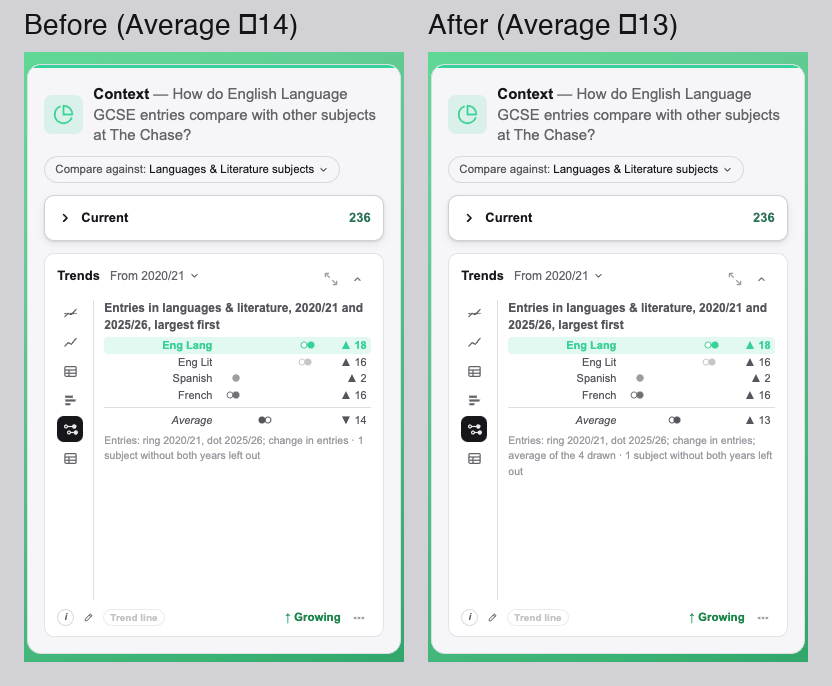
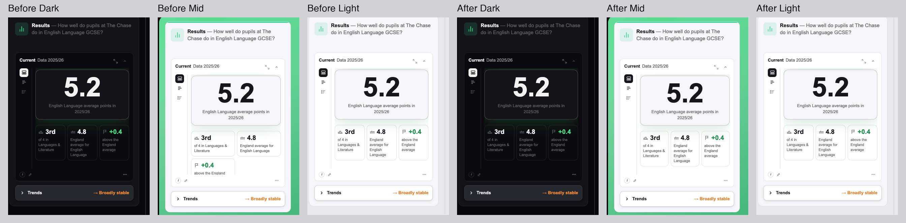
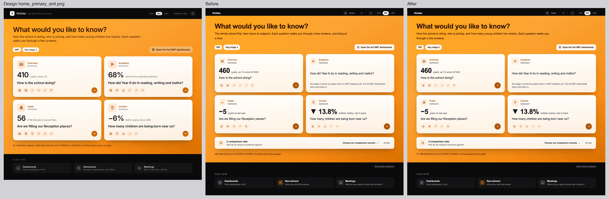
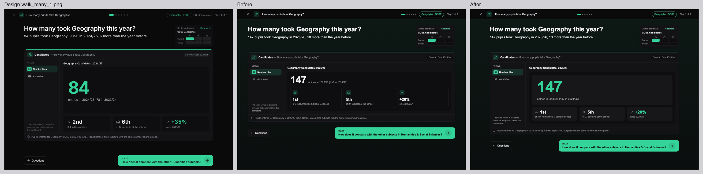
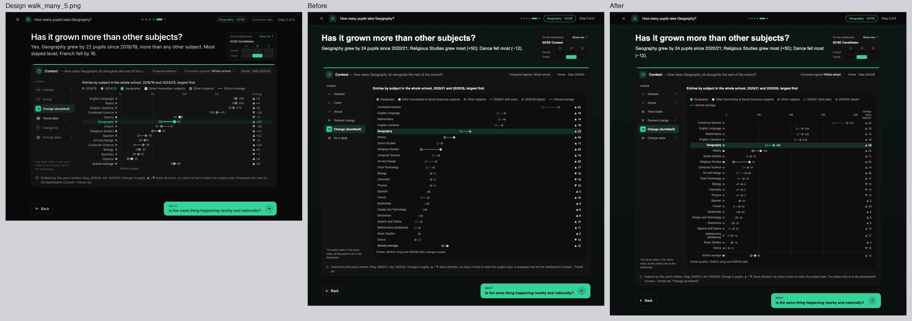
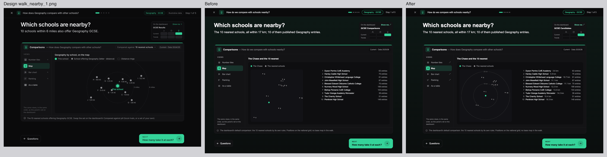
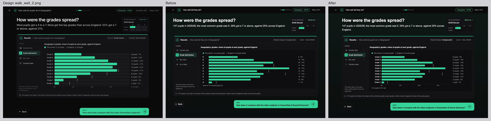

# VicData 0.8 front door: the design cross-check — report

Built straight through, unattended, from `docs/v0.8/vicdata_0_8_front_door_design_crosscheck_claude_code_prompt_v1.md`, on branch **`v0.8-front-door-crosscheck`** (from `main` 284e083, which holds front door Parts 1, 2 and 2b and group sets). Local, not pushed or merged. **Nothing was written to any database**, **no migration**, and **no published dashboard config changed** (so no republish). Every call is in `docs/OPEN_QUESTIONS.md` under "2026-11-13: front door, design cross-check".

## How far it got

| Milestone | What | Commit |
|---|---|---|
| M1. The grabs and the side-by-sides | every board against the built screen, drawn from the app's own components (the real home page, `WalkPage`, `GroupHome`, `TeacherDashboard`, the sets and admin pages) with real data; one side-by-side per board in `docs/v0.8/front_door_crosscheck/` | `907aa05` |
| M2. The differences, classified | `docs/v0.8/front_door_crosscheck/differences_v1.md`, every board, region by region, written and committed before any fix | `907aa05` |
| M3. The misses resolved | 23 misses fixed, the after pictures in `docs/v0.8/front_door_crosscheck/after/` | `4cd7dca` |
| M4. The report | this file | (this commit) |

All four milestones are done, each clean (Tests and parity, below).

**The totals: 23 misses found and 23 fixed; 41 differences decided (kept, each citing its decision); 10 Guy's calls; about 135 differences of data only (counted, not listed).**

## Guy's reviewer's two items

**1. The dumbbell's "Average" on GCSE Candidates' Context › Trends (The Chase, English Language): a miss, fixed.** The row was the Context panel's group line, the comparison group's per-subject average, which is a mean taken *each year over every subject the group holds that year*. Languages & Literature holds five subjects at The Chase; one has entries in only one of the two years, so the dumbbell leaves it out ("1 subject without both years left out"), but the group line kept it at one end. So the row averaged a different set of subjects at each end and read **▼ 14** while all four rows drawn rose (+18, +16, +2, +16). The board's "school-average row last" is "the plain average of the 14 subjects" drawn. The row is now the plain average of the rows drawn, the same subjects at both ends: **▲ 13**. The card keeps the short label "Average" (it sits directly under the rows it averages, and now is their average); full screen and the hover say "Languages & Literature average: the 4 subjects drawn, both years", and the card's note adds "average of the 4 drawn". `src/lib/teacher-dumbbell.ts`, its tests (a case where every row rises and the group line falls), R-DUMBBELL's statement.



**2. GCSE Results' Current panel in Mid (The Chase): "+0.4 above the England average" clipped: a miss, fixed.** At a 1440 window in Dark and Light the card is about 280 px inside and the three tiles sit across; in Mid the coloured field's padding leaves about 265 px, so three 5.5rem tiles wrapped to two rows and the panel's fixed height cut the third off. Light at 1440 was fine; **the parity run found the same clip in Dark at a 1280-wide window on `main`** (Acland Burghley 100053, English Language, "+0.8 above the England"), so it isn't Mid's alone: any card under about 276 px. The tiles' minimum is now 5rem: three across in all three themes at 1440 and in Dark at 1280; at 1440 Dark and Light don't move (`src/components/teacher/NumberTiles.tsx`).



## Per board

The full table, region by region, is `docs/v0.8/front_door_crosscheck/differences_v1.md`. Each board's side-by-side (design left, build right, same scale) is beside it; where something was fixed, `after/` has design, before and after.

### The homes (Mid, 1280)

| Board | Composite | Misses (fixed) | Decided | Guy's calls |
|---|---|---|---|---|
| `home_teacher.png` (Leighton Park, GCSE + Post-16) | `home_teacher.png` | — | white pill buttons on the field (P1 M2); "4th of 4: us and the 3 nearest" (P1 M3); Post-16 points per entry (P1 M3); Show fewer questions (B10); the nav (P1) | G1 typeface; G2 school name in the header; G3 "My subjects" in Also here |
| `home_smt.png` (Leighton Park) | `home_smt.png`, `after/home_smt.png` | Pupils badge (the year-groups stack) | Context's "▼ 0.5%" (2b M1); icon rows from the walks' configuration (B12); the sets card (D21) | G1, G2 |
| `home_primary_smt.png` (Ash Green Primary Academy, 142990) | `home_primary_smt.png`, `after/home_primary_smt.png` | the primary line under the heading; the note's (i); Pupils badge | Academic without a figure, Pupils without Reception places (P1 M5) | G4 Context's figure (projection, under a births question); G3 Admissions in Also here |
| `home_group.png` (Harris) | `home_group.png`, `after/home_group.png` | Pupils badge | the tiles' figures (P1 M3, 2b M1) | G5 chips and the "Our schools" line |
| `home_admissions.png` (Leighton Park, 11+) | `home_admissions.png` | — | the screens' own icons, entry names, Market share's measure (B14, P1 M5); the sets card (D21) | G1, G2 |



### The three GCSE walks (Dark, 1280 × 900; The Chase, Geography)

Every screen had the same seven misses, all fixed in `WalkPage.tsx`: **the step dots centred** in the header; **the boards' 1060 px column** (was 1160); **the mini-map names the dashboard** ("GCSE Candidates", "GCSE Results"), not a column ("GCSE Context"); **the rail is the dashboard panel's own** (its config's views in order, its table view switching in place, ↗ on views that open the dashboard; it had listed the catalogue's views for the host, taking Results' "Chart" onto a Candidates screen and dropping the tables); **the column questions** of vocabulary §1 ("How well do pupils do in Geography?", "How does Geography compare with other schools?"); **the pill** drawn as the dashboard's (label, then the setting); **Back** outlined.

Per screen (`charts.tsx`, `teacher-screens.ts`):

| Board | Fixed | Kept |
|---|---|---|
| `walk_many_1`, `walk_well_1` | the tiles: a large lead figure in the focus colour on its own plate, each tile's icon beside its figure, a rise in the focus colour | |
| `walk_many_3`, `walk_well_4` | | G6: more than 10 subjects draw as horizontal bars |
| `walk_many_5` | the dumbbell at walk size: an axis with round ticks and gridlines, the latest value beside each dot, "Change since …", a square in each row's colour beside its name; the note no longer calls it "a proposed view" (it is on the dashboard since 2b) | its place on the dashboard's rail (2b) |
| `walk_many_6`, `walk_well_6` | the key names each line as its end label does; the end labels stay inside the plot (Worcestershire's sat on the year labels) | "Proposed addition" (P1 M5: the 10 nearest on the Area chart stays a proposal) |
| last screens | "Finish · See what you found" (every walk, the role walks too) | |
| `walk_well_2` | "Grade 9", "9 pupils · 6%", a % axis | the pill on Average points (B12) |
| `walk_well_5` | | G7: Geography against England, not its Humanities peers |
| `walk_nearby_1` | the map centred on the school with dashed km rings; each school's distance in the list | no base map, a numbered list (P1 M5) |
| `walk_nearby_2`, `_3` | the name column wide enough for the schools' names | G8: by value without the nearest's average line (board: by distance, with the average) |
| `walk_nearby_4`, `_5` | ranks and places as ordinals (1st, 2nd; "Our place 5th", an axis of 1st … 5th); the ranking table's row rules in the grid colour (they drew in the text colour) | |









### The other boards

| Board | Composite | Result |
|---|---|---|
| `other_roles.png` | `other_roles.png` | Decided throughout: a "draft for discussion"; the homes' boards (later) and B12 set the SMT and Admissions walks (Admissions has two, one per home card); SMT orange (C20) |
| `vocabulary.png` | `vocabulary.png` | §1 column questions, §2 pills, §3 the rail and §5 labelling: misses, fixed with the walks; §4 colours match; §6's six proposed dashboard changes Decided (in no prompt; dashboards unchanged) |
| `dumbbell.png` | `dumbbell.png`, `after/dumbbell.png` | walk size fixed (above); dashboard size: the Average (reviewer item 1) fixed; its place after Ranked change Decided (2b M2) |
| `themes_ladder.png` | `themes_ladder.png`, `after/results_current_three_themes.png` | the ladder matches in Dark and Light; its early Mid superseded (2b M3); Mid's clipped tile (reviewer item 2) fixed; a shut Trends bar's direction word in the trend palette Decided (P1 M2: figures take the accent, as Context's "Current 236" does) |
| `sets_library.png` | `sets_library.png` | matches; round 1's Sort, Folders, row menus and sidebar sections Decided (P2 M1) |
| `sets_editor_feeders.png`, `sets_editor_rivals.png` | both | match; the map's base layer is the harness (CARTO needs the production key: live check); "This set now" in Attainment 8 / A-level points Decided (P2 M1); G9 the rivals' line naming the school's profile |
| `admin_account.png` | `admin_account.png` | matches; no Sign-ins row (Part 3), Head office sharing only with a group account, Dark under Mid: Decided (P2 M2, R-THEME-MID-SCOPE) |
| `membership.png` | `membership.png` | matches; "seats", payments disabled and the board's "Other states" notes Decided (P2 M2) |
| `walk_home_prototype.png` | — | skipped (superseded by the homes) |

### The screens with no board

| Screen | Against the prompts' words |
|---|---|
| Welcome, setup (A5, A6) | match (`first_visit.png`) |
| "New since your last visit" and the changelog page (A7) | match: one line, the link, gone once seen, an entry dated after today held back (`first_visit.png`). G10: the seeded entry's "Mid gives the homes and walkthroughs their own colour" is stale since 2b |
| "Here's what you found" | matches B13 (every answer with where it lives, the other questions, the full dashboard); its Back outlined like the footer's |
| Phone (G), 36 screens at 390 × 844 | no sideways scroll on any, before and after the fixes (`phone_390.png`); the fixes' own phone layouts checked (the header's question on its own line, the grades and their % axis) |

## Guy's calls

1. **G1. The typeface.** The boards are drawn in Inter; the app's `body` is Arial, so every heading reads heavier and wider than the boards. *Recommendation:* set the app's sans to Geist (already self-hosted in `fonts.css`, unused) or self-host Inter, in a round of its own with full parity, since it moves every page. Not as a front door fix.
2. **G2. The school's name in the header.** The boards put "V VicData · [school]" and the person's initials there; the homes and walks draw `TeacherNav` (Home, menu, account icon), which names no school, while the admin pages' header does. *Recommendation:* add the school's name after "VicData" in `TeacherNav` (one line; it moves every dashboard's header by a few words, so a shell round's parity).
3. **G3. "Also here" extras per role.** The teacher board has "My subjects · Geography, History · change"; the primary SMT board has "Admissions · Reception applications and offers". The build keeps today's (Recruitment). *Recommendation:* add "My subjects" for teachers (to `/teacher/setup`, listing the ticked subjects), so the home shows which subjects it follows and how to change them. Keep Recruitment for SMT.
4. **G4. A primary school's Context tile.** Its question is "How many children are being born near us?" but its figure is the projection ("▼ 13.8% children nearby, next 5 years", 2b's SMT Context figure); the board has births ("−6% births nearby since 2019"). *Recommendation:* for a primary-only school, take the figure from the same walk's births screen (DV-SMT-C-BIRTHS) so the figure answers the question.
5. **G5. The head office home's chips and "Our schools" line.** Board: "All schools · GCSE · Post-16" and "Each opens its own SMT home"; build: the group's name and "Open any member school's SMT dashboards". *Recommendation:* draw the scope chips as SMT's home does (shown, not yet filters) and keep the build's line, which is truer (a school without access opens its public page).
6. **G6. More than 10 subjects as horizontal bars** (walk screens "And across the whole school?"). The board draws 14 upright bars with short names. *Recommendation:* keep horizontal bars: at 22–27 subjects upright bars need two-line abbreviations, and the full names read better.
7. **G7. "Are results going up or down?"** draws Geography against England; the board draws Geography among its Humanities peers. *Recommendation:* keep England (the one reference with a figure every year, and screen 6 brings in the peers' nearby context); the peers are one tap away on the rail.
8. **G8. "How many take it at each?" / "How did they do at each?"** are ordered by value without a line for the nearest's average; the board orders by distance with the average dashed. *Recommendation:* keep the order (the question is "how many"), add the dashed average of the nearest (one line in `HBars`).
9. **G9. The rivals editor's line.** Board: "…with a similar profile: independent, day and boarding, a similar size"; build: "…a similar profile to yours". *Recommendation:* name the pre-selected chips in the line (they are the profile), in a sets round.
10. **G10. The changelog's seeded entry** says "Mid gives the homes and walkthroughs their own colour"; since 2b Mid colours the dashboards too. *Recommendation:* reword it before 1 December ("Mid gives the homes, walkthroughs and dashboards their own colour"): if the seed is already applied, one `update public.changelog_entries set body = … where title = 'A mid-tone theme, and clearer panels'`; the seed file can take the same words.

## Screens only checkable live (for Guy's live check)

- **The guided sets editor's map** with its base layer (the harness has no CARTO key): `/sets/guided?urn=110110&kind=feeders&entry=11%2B`, and rivals.
- **SMT's and Admissions' walks** (they draw the dashboards' own views, signed in): `/teacher/walk/smt-overview`, `/teacher/walk/admissions-pipeline`; check the last screen's "Finish · See what you found".
- **The KS2 dashboard in Mid** (no harness fixture): `/teacher/ks2` with Mid.
- **The dumbbell's Average** on `/teacher/ks4` → Candidates → Context › Trends → Change (dumbbell), The Chase, English Language: ▲ 13; full screen names "Languages & Literature average: the 4 subjects drawn, both years".
- **GCSE Results' Current panel in Mid**, The Chase: three tiles across, nothing cut off; Dark and Light as before.

## Tests and parity

| Check | M1–M2 `907aa05` (docs only) | M3 `4cd7dca` |
|---|---|---|
| tsc | clean (code = `main`) | clean |
| eslint | — | 0 errors (3 warnings, all older) |
| build (`next build`) | — | passes |
| Unit, every `src/**/*.test.ts(x)`, one file per process | — | 92 files, 710 pass, 0 fail (the front-door and dumbbell files re-run after the last edits: 0 fail) |
| Catalogue unit | — | pass |
| PGlite, every suite (RLS and usage log among them) | — | 29 / 29 |
| Rule tests, the full suite (production reads, read-only) | — | 180 pass, **1 fail: R-REPORT-COMMANDS-ORDER on `non_mainstream_groups_production_report_v1.md` (no "## Guy's commands"), failing identically on `main`** (this report's name, as the prompt gives it, isn't in that rule's `*report*.md` pattern; its commands follow the seven steps); 15 manual, 19 no test, 8 superseded. The 16 front-door rules re-run after the last edits: 16 pass |

### Parity (words against `main` everywhere; pixels only where a fix intends them)

Harnesses: Part 2's and 2b's (headless Chromium 131, the app's own components and built CSS), fixtures captured from each tree's own code, **byte-identical between the trees in every harness** (Teacher 10/10; SMT, Admissions and the Group pages by hash). Branch working tree at `4cd7dca` against `main` 284e083. A pair is compared as PNG pixels, DOM (the harness's own bundle and fixture names set aside) and words.

| Harness | Pairs | Words | Pixels |
|---|---|---|---|
| Teacher walker, 7 case sets (every panel × rail view, both themes, 1280 and 390) | 2,666 | **every word identical except the 21 dumbbell views**, whose Average changes as intended (the figure, and "; average of the n drawn" in the note). `main`'s Average was wrong in most of them, not only The Chase's: Acland Burghley ▼ 45 → ▲ 6, Croydon College ▼ 52 → ▼ 11, its A-level law ▼ 41 → ▼ 17, Sevenoaks ▲ 10 → ▲ 5 | 2,626 identical. Of the other 40: the 21 dumbbells; **2 Number tiles (Acland Burghley, Dark, 1280): the fix, the third tile no longer cut off**; 11 the bar chart's first-measurement height (the known flake, words equal); 6 one ranking case (`rk-137625-reg-grade9`) where `main`'s walker was caught still loading ("Loading map…", "Loading History…"): a timing flake on `main`'s side, the branch's side complete. 47 pairs only on `main` and 186 only on the branch come from walker cases that failed on one side (6 on `main`, 2 on the branch, all at 390), never counted as passes |
| Public school page SSR (137625, 117037) | 2 | byte-identical | — |
| Admissions, 4 schools × entry points × both themes × 1440 and 390, every rail step | 468 | identical | **468 identical** |
| SMT, 2 schools × 4 dashboards × both themes × widths, every rail step | 150 | identical (DOM too) | 134 identical; 16 pixel-only: a 7 × 6 px patch on Overview (the map's loading placeholder corner) and a 3 px strip on Context's map, the drift 2b documented by run. No SMT code changed |
| Group pages and the head office home, Harris and Dukes, both themes and widths | 176 | identical (DOM too) | 167 identical; 8 the head office home's Pupils badge (18 × 16 px, intended); 1 sub-threshold (no pixel over 8/255). The Mid head office home against `main`'s: the badge only |

**Pixels changed on purpose, in words-identical pictures:** the head office home's Pupils badge; Number tiles three across where a card is under ~276 px (Dark at 1280 here; Mid everywhere). **Words changed on purpose:** the dashboard dumbbell's Average and its note. The homes and walks (front door pages) aren't in the parity harnesses: their before and after are the composites in `docs/v0.8/front_door_crosscheck/after/`, and their phone layouts were re-measured (36 screens at 390, no sideways scroll; the fixes' own phone layouts checked by eye).

Harness copies and outputs are in the session scratchpad (`h/` for the front door pages, `tpar/`, `spar/`, `apar/`, `gpar/`, `pxcmp.py`, `tclass.py`).

## Guy's commands

The branch `v0.8-front-door-crosscheck` is local, not pushed: the worktree at `~/.t3/worktrees/vicdata_public/t3-794168c0` shares the repository with `~/dev/vicdata_public`. The live site is **`https://vicdata.co.uk`**.

**1. Migrations:** none (no table changed).

**2. Merge and push** — from `~/dev/vicdata_public` on a clean `main`:

```
cd ~/dev/vicdata_public && git checkout main && git pull https://github.com/guyVicData/vicdata_public.git main && git merge --no-ff v0.8-front-door-crosscheck -m "0.8 front door design cross-check: every board against the build; 23 misses fixed (the walks' rail, mini-map, header and charts; the dumbbell's average; Mid's clipped tile; the homes' badges and lines)" && npm run build && git push https://github.com/guyVicData/vicdata_public.git main
```

**3. Render deploys main on its own** (auto-deploy, On Commit). If no deploy starts within 5 minutes, deploy by hand.

**4. Wait until /api/version shows the merge commit.**

```
cd ~/dev/vicdata_public && M=$(git rev-parse --short=12 HEAD) && until curl -s https://vicdata.co.uk/api/version | grep -q "\"commit\":\"$M\""; do echo "waiting for $M"; sleep 30; done && curl -s https://vicdata.co.uk/api/version
```

**5. Republish:** none (no fix touched a published dashboard config: the dumbbell's average and the tiles' width are component code).

**6. Set fixed:** none (no feedback items).

**7. Live check** — on vicdata.co.uk, the list above ("Screens only checkable live"), plus: a GCSE walk (`/teacher` → "How many pupils take …?") screen by screen: the dots centred in the header, the mini-map naming "GCSE Candidates" or "GCSE Results", the rail matching the dashboard panel's (↗ on the views that open it), the dumbbell's axis and values, the map's rings, "Finish · See what you found"; and an SMT member's and a head-office user's home: the Pupils tile's stack icon.
