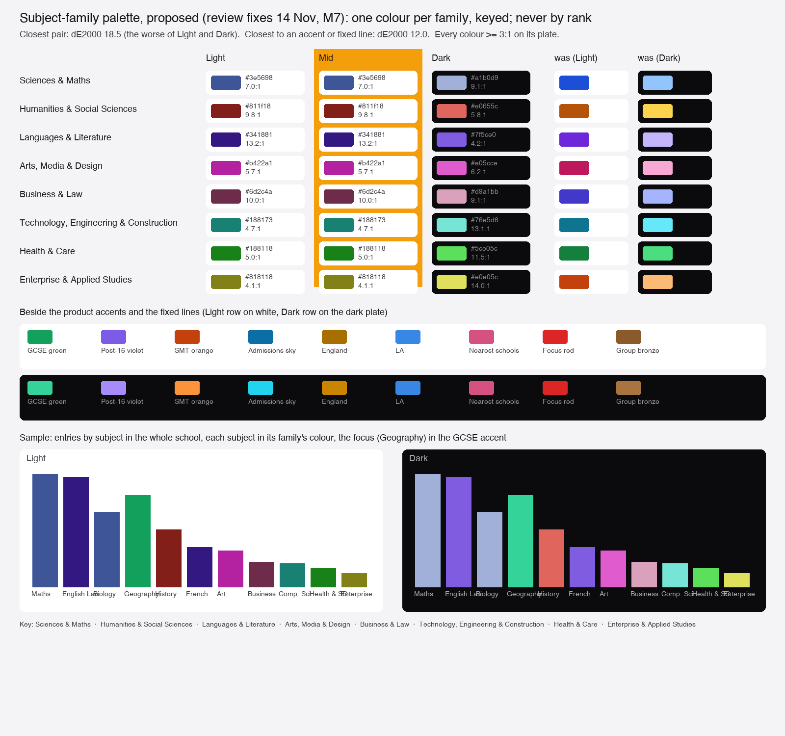

# VicData 0.8: the 14 Nov review fixes, report

Branch `v0.8-review-fixes`, from `main` bf41d93, in its own worktree. Not pushed or merged. Every call made without asking is logged under "2026-11-14: review fixes" in `docs/OPEN_QUESTIONS.md`.

## The milestones and their commits

| | What | Commit |
|---|---|---|
| M1 | The wrong figures and wrong charts, with tests on real fixtures | 73138b3 |
| M2 | The walks nobody had looked at: drawn, read and fixed; the harness | 6347045 |
| M3 | The walks' wording: 31 findings and the rules behind them (R-WALK-WORDS) | 258e3de |
| M4 | Tables and rankings (R-RANK-OF-N) | e24b441 |
| M5 | Chart titles (R-CHART-TITLES) | b0d70ae |
| M6 | Repeated tables, the missing graph, the dumbbell (configs change) | 9947464 |
| M7a | The palette board, committed before it was applied | 52b7428 |
| M7b | Subject-family colour applied (R-SUBJECT-COLOUR); the new rules and their runners | d9c6c92 |
| M8 | This report, the screenshots, the catalogue | (this commit) |

**One honest caveat about the commits.** M2 to M6 changed many of the same files: `teacher-screens.ts`, `walks.ts`, `GroupDashboard.tsx`, `charts.tsx` and `dataviews.ts`. Each file went in at the milestone that carried most of its change, and each commit message names what it carries from the others. Only M1 (73138b3), M6 (9947464) and M7b (d9c6c92) were checked on their own trees. The commits between them were not checked one by one, and some may not build alone: M3's `walks.ts` names the Rank over time view, which only arrives with M6.

## Findings: fixed, not a bug, or left

### walks.md

| # | Result |
|---|---|
| 1 | **Fixed (M1).** Every placeholder is filled (`walk-titles.ts`). A title that can't be filled falls back to the view's label. A test checks every title on every walk. |
| 2 | **Fixed (M1).** The header takes the walk's own context: "…join us at 11+ (Year 7)?". |
| 3 | **Fixed (M1).** The indexed chart starts at its base year, so every line is 100 where the caption says. The "(index N) since" sentence uses the same year. |
| 4 | **Fixed (M1).** The sort is on `total`, with the casts removed (`largestYearGroup`). Leighton Park's largest is Y13 (98), not Y7. |
| 5 | **Fixed (M1).** Uses the last year with a place, each place labelled with its own year and "of N". The answer says when the latest year has no place. |
| 6 | **Fixed (M1).** The answer is built from the values ("Physics entries here rose 43% since 2021/22 (index 143), against 115 at the 10 nearest schools, 107 in Reading and 114 in England"). Only the lines that have a figure are named. |
| 7 | **Fixed (M1).** Every Admissions answer is a whole sentence, including when nothing is loaded. The pipeline's change gives its year. |
| 8 | **Fixed (M3).** Each answer is computed from what its view draws: top mover, top band, pool change, leader and our rank, the largest age, the largest share gain, the head office shape and areas. |
| 9–23 | **Fixed (M3).** `words.ts`, plus tests on every walk. |
| 24 | **Fixed (M3).** Questions reworded. The primary Pupils walk now asks what its screens answer. |
| 25 | **Decision (logged).** Questions use "we/our". Answers name the school or say "here". Admissions keeps "you/your", because its titles do. |
| 26 | **Fixed (M3/M5).** Lower-case nouns; titles come from the catalogue. |
| 27 | **Fixed (M3).** "Other subjects in its area" / "the area's average". |
| 28 | **Fixed (M3).** "(all 5 groups have a figure)". |
| 29 | **Fixed (M3).** BTEC grades sort D*, D, M, P (`gradeOrder` with `isBtecGrades`). |
| 30 | **Fixed (M1).** Feeders are counted once (`feederCount`). |
| 31 | **Fixed (harness).** Steps are 1-based in the new harness. The old harness's `step=0` drew step 1. |
| G1 | **Fixed (M1)**, same fix as #3. |
| G2 | **Fixed (M1).** Phone bars use `minmax(0,38%)`. A test pins the classes. |
| G3–G9 | **Fixed (M2).** |
| G10 | **Left.** The group side-by-side table scrolls sideways at 390, and the pickers truncate. These are dashboard components (logged). |
| T1–T4 | **Fixed (M4).** Entries per school, year and N in the captions, table headers, the map list's year, "no figure". |
| T5–T6 | **Fixed (M3).** The answers name the leader's figure and our rank. |
| "No screenshot exists for…" | **Fixed (M2).** See Screenshots below. SMT Context's map now draws in the walk (it was a link). |

### dashboards.md

| # | Result |
|---|---|
| 1 | **Fixed (M1).** The walk draws through the dashboard's own `viewBody` (`AdmissionsWalkBody`). A test renders it against EntryNow and PoolTrends on Leighton Park's real answer. |
| 2 | **Fixed (M6).** Rank over time (DV-C3-TR-RANK) is on Comparisons › Trends. The walk points at it. |
| 3 | **Left (M6, logged).** The walk keeps the nearest-schools line. The dashboard's area chart would need the comparison set's series fetched into the Candidates/Results host. |
| 4 | **Fixed (M5).** "Market share at 11+: you and your largest rival (…)". |
| 5 | **Fixed (M1).** Positions come from the config; all nine are in a test. |
| 6–8 | **Fixed (M7).** |
| 9 | **Fixed (M6).** |
| 10 | **Fixed (M6).** Scale floor, ticks, `?against=whole`. |
| 11 | **Left.** Trend charts have no value axis. This isn't among Q1–Q8. Logged for a dashboard round. |
| 12 | **Partly fixed.** The walks' clipping is fixed. The dashboard tiles were already fixed in the 2b cross-check. Not re-measured here. |
| 13 | **Not changed.** The header span is the dashboard's own. Logged. |
| 14 | **Not re-shot.** The dashboard's own dumbbell wasn't drawn in this harness. The walk's dumbbell is in `colour/`. The new scale needs a live check. |
| Titles | **Fixed (M5),** apart from the Teacher hosts' own strings beyond those named. Logged. |
| Repeated | **Fixed (M6):** Admissions donut and share ranks, SMT mix table, A-TABLE change column, A-level chip, SMT Current tiles. "Biggest moves" is kept: the review allowed it. |

### tables.md

| # | Result |
|---|---|
| H1 | **Fixed (M1).** `fsmCell`. No current school in the fixtures is under 10 pupils, so no figure moves. The test runs on production's own small school-years (Aspire, and Nexus's past years). |
| H2, H3 | **Fixed (M4).** |
| M1–M8 | **Fixed (M4).** |
| L1–L10 | **Fixed (M4).** L5's census label is the census year. |
| Repeated info | **Fixed (M6).** SMT Overview tiles. Group Overview "3 yrs" is labelled. Group Academic's side by side was accepted by the review, so it was left. |

## M1's figure changes, before and after

| Where | Before | After |
|---|---|---|
| SMT Pupils, largest year group (Leighton Park) | "Year 7" (always the first) | "Y13, with 98 pupils" |
| Teacher nearby trend, latest year missing | "Up: 5th in 2021/22, 3rd in 2025/26" (3rd was 2023/24) | "…, 3rd of N in 2023/24. The school has no place for 2025/26." |
| Teacher entries area (Physics, falling) | "No: … grown more slowly" | "Physics entries here fell 67% …" |
| Indexed "nearby and nationally" | lines 100 at the first shared year, axis from an earlier year | the chart starts at the base year: every line 100 there |
| Admissions P-NOW and P-PIPELINE screens | the cohort bars and the pool trends | the dashboard's EntryNow tiles and PipelineChart |
| Group Schools FSM, under 10 pupils | DfE's % (e.g. 0.0%) | "too few pupils (n)", `fsm` null |

Group data parity (the dash route's body for Harris, Dukes and Nexus; 48 responses, base against branch): **no figure moved.** The 380 changed values are all words: `typeSize` "59 schools" became "59 members", and `rank` gained "on Att 8". The only new field is `fsmFewPupils`.

## M2's screenshots

The harness is `docs/v0.8/audit_scripts/review_fixes_preview`. It renders the app's own WalkPage and the real dashboard components for every walk, on the routes' real answers, in headless Chromium 131. It covered:

- **246 shots:** SMT (4 walks), Admissions (2, plus 16+), Post-16 (3), head office (4), Teacher nearby 2–4 at 390, and the empty states (a 1-pupil GCSE subject, a special trust's Academic walk);
- each at 1440 and 390, in Mid, plus Dark for one walk of each kind;
- the walks' end screens.

**Reading.** Three reviewers read the before set. Rate limits cut one of them to 34 of 111 images, so the after set was downscaled into slices and two more reviewers read it. Their results are listed under Tests and parity. The committed set is in `docs/v0.8/review_fixes_screenshots/walks`: Mid 1440 for every step, the 390 phone firsts, the Teacher nearby phones and five Dark screens.

**Misses found and fixed:**

- every role walk drew its title twice;
- SMT Context's map was a link;
- the special trust's Academic walk drew blank panels and gave the wrong reasons;
- "within 1 points";
- the end screen named the wrong panel for a view in a multi-view cell;
- labels for unpublished years running together;
- a bar's value sitting on the average line;
- one-year segments not drawn;
- end labels cut off;
- the 110% tick;
- map numbers colliding;
- "no entries" for a missing figure;
- phone year labels running together;
- head office counts that disagreed (54 / 59 / 26 against 25) without saying why;
- the dumbbell's title reading "2020/21 and 2020/21".

**The after-set SMT pass** (all 109 slices seen) found, and this commit fixes in the answers: the roll line not naming which roll it draws ("Grown (day): …"); "103% stayed on" (now "Year 12 was 103% of the year before's Year 11: more joined at 16 than left"); England listed as a phase; the area answer ignoring the projection the chart draws; the age answer not saying it covers the school's ages. It also saw, and these are left (dashboard components or data, logged): the SMT market footnote reading like a developer note; the RankChart legend without swatches; Context's births and projection on one unlabelled scale; the 2021/22-to-latest results line beside the Scorecard's 2022/23 change (the walk's answer carries the grading caveat); context step 2 repeating step 1's LA list; Next labels truncated on a phone (by design: one line).

**The after-set Teacher/Admissions pass** (all 125 slices seen) found, fixed in the follow-up commit: the special trust's Academic step 4 saying "no results … yet" (now the same reason as its other steps); the nearby ranking's note claiming the same figure shares a place, when places are ranked on the unrounded figure (the note now says so). Already fixed after these shots were taken: the dumbbell title's "2021/22 and 2021/22" and phone year labels running together. Left (dashboard components or edge cases, logged): the Admissions ranked bars and momentum scatter on a phone (the donut and table side by side, labels cut, the flags table missing at 390) and the rivals table's 11th row clipped at 1440; the scatter subtitle's "Post-16 results" wording at 11+; the dumbbell's value labels on the subject squares at 390; the 1-pupil subject's empty-state titles naming lines it can't draw; the tile with no value drawing a bare bar; the special trust's roadmap note ("Later: …"); vertical-bar labels breaking mid-word at 390; Next labels truncated on a phone (one line, by design).

**Seen and left** (dashboard components, logged): trend charts without a value axis; the momentum scatter's labels; phone tables that scroll sideways; truncated pickers.

## M7: the palette



- **Spacing.** The closest pair is CIEDE2000 18.5 (the worse of Light and Dark).
- **Distance from fixed colours.** Every family colour is at least 12.0 from GCSE green, Post-16 violet, SMT orange, Admissions sky, England, LA, the nearest schools, the focus red and the group bronze.
- **Contrast.** Each colour is 4:1 or better on its plate.
- **Mid** draws on white plates, so its values equal Light's.
- **One for Guy to look at live:** Health & Care's green beside GCSE's accent. It passes on the numbers but reads close by eye.

The colour screenshots are in `docs/v0.8/review_fixes_screenshots/colour`, in Dark, Mid and Light at 1440 and 390:

- whole-school bars;
- the dumbbell;
- the category trend lines;
- SMT's subject areas;
- head office's subject areas.

**Not drawn:** the dashboard pages themselves in three themes. This round's harness draws the walks, which use the same components. That check is on the live list (step 7).

## Republish dry runs

`scripts/dashboards-seed-sql.ts --force --only <ten slugs>` printed 259 KB of SQL. It was not run. Each slug's code config, compared with the 13 Nov published snapshot:

| Slug | Changes |
|---|---|
| vicdata.ks4.candidates | c3.trends + DV-C3-TR-RANK (the + DV-C2-TR-DUMBBELL is 2b's, already republished after this snapshot) |
| vicdata.ks4.results | c3.trends + DV-C3-TR-RANK |
| vicdata.ks5.candidates | c3.trends + DV-C3-TR-RANK (and 2b's dumbbell, as above) |
| vicdata.ks5.results | c3.trends + DV-C3-TR-RANK |
| vicdata.smt.overview | panel names: Roll, Results |
| vicdata.smt.academic | panel names: Results, Every line, Entries mix; − DV-SMT-A-MIX-TABLE |
| vicdata.smt.pupils | panel name: Roll by phase |
| vicdata.smt.context | panel names: Where the children live, Births |
| vicdata.admissions.pipelines | panel names: Your cohort, The pool |
| vicdata.admissions.market-share | − DV-ADM-M-DONUT, − DV-ADM-M-SHARE-RANKS; panel names: You and your rivals, Market share |

## Tests and parity

| Check | Base (bf41d93) | Branch |
|---|---|---|
| tsc | clean (the generated `LayoutProps` error before build, as every round) | clean |
| eslint | 0 errors, 3 warnings | 0 errors, the same warnings |
| build | pass | pass |
| Unit tests, one file per process | 93 files, 717 pass, 0 fail | 98 files, 749 pass, 0 fail |
| Catalogue unit | 77 / 77 | 77 / 77 |
| Rule tests (production reads, read-only) | PASS 188, FAIL 0 | PASS 193, FAIL 0 |
| PGlite, every suite (the PostGIS three with PGlite 0.5.5) | 29 / 29 | 29 / 29 |

**Rules rewritten, and why** (all logged):

- **R-SCORECARD-ROWS-BY-TYPE:** the header now reads "10 nearest rank".
- **R-INDEP-ENTRY-TILES:** a state school's Current no longer repeats Attainment 8 and Progress 8. The Scorecard holds them.
- **R-MARKET-FOLLOWS-SET:** the title still says "against {set}".
- **R-WALK-KEYS:** a family-coloured row is keyed by its family.

**Extended:** R-DUMBBELL, R-THEME-CONTRAST, R-WALK-KEYS.

**New:** R-WALK-WORDS, R-WALK-PANEL-LINK, R-RANK-OF-N, R-CHART-TITLES, R-SUBJECT-COLOUR. `docs/catalogue/*.md` is regenerated.

**Final run on d9c6c92:** eslint 0 errors (the same 3 warnings as base); build pass; tsc clean; **rule tests PASS 193, FAIL 0, ERROR 0** (15 manual, 19 no test, 8 superseded; base 188 plus the five new); catalogue unit 77 / 77; PGlite 29 / 29; **unit tests 98 files, 749 pass, 0 fail** — the one failure on d9c6c92 (the preset table doc stale after the dumbbell title's span fix) is fixed in this commit by regenerating it.

## Guy's commands

The branch `v0.8-review-fixes` is local and not pushed. Its worktree shares the repository with `~/dev/vicdata_public`, so the branch is already there.

**1. Migrations:** none (no table changed).

**2. Merge and push:**

```
cd ~/dev/vicdata_public && git checkout main && git pull https://github.com/guyVicData/vicdata_public.git main && git merge --no-ff v0.8-review-fixes -m "0.8 review fixes: walks' figures, charts and words; tables and ranks; titles; repeated tables; rank over time; the dumbbell; subject-family colour" && npm run build && git push https://github.com/guyVicData/vicdata_public.git main
```

**3. Render deploys main on its own.** If no deploy starts within 5 minutes, deploy by hand.

**4. Wait until /api/version shows the merge:**

```
cd ~/dev/vicdata_public && M=$(git rev-parse --short=12 HEAD) && until curl -s https://vicdata.co.uk/api/version | grep -q "\"commit\":\"$M\""; do echo "waiting for $M"; sleep 30; done && curl -s https://vicdata.co.uk/api/version
```

**5. Republish the ten slugs** (after step 4), then check their versions:

```
cd ~/dev/vicdata_public && test "$(cat supabase/.temp/project-ref)" = "lnhulykjlxmoneappnsp" && npx -y tsx scripts/dashboards-seed-sql.ts --live https://vicdata.co.uk --only vicdata.ks4.candidates,vicdata.ks4.results,vicdata.ks5.candidates,vicdata.ks5.results,vicdata.smt.overview,vicdata.smt.academic,vicdata.smt.pupils,vicdata.smt.context,vicdata.admissions.pipelines,vicdata.admissions.market-share > /tmp/review_fixes_republish.sql && supabase db query --linked -f /tmp/review_fixes_republish.sql && supabase db query --linked "select d.slug, v.version, v.label from dashboards d join dashboard_versions v on v.id = d.published_version_id where d.slug like 'vicdata.ks%' or d.slug like 'vicdata.smt.%' or d.slug like 'vicdata.admissions.%' order by 1"
```

Expect each of the ten one version up.

**6. Set fixed:** none (no feedback items).

**7. Live walk-through** on vicdata.co.uk:

- **An Admissions walk at 11+** (View as… → Admissions, Leighton Park):
  - the header says 11+ (Year 7);
  - screen 1 is the dashboard's Entry point now tiles;
  - screen 2 is the Pipeline chart;
  - no title is a fragment, and no answer is blank;
  - the mini-map lights the panel each view lives in.
- **An SMT walk** (Overview, then Pupils and Context):
  - each title appears once;
  - "Its largest year group is Y13";
  - Context step 2 draws the map.
- **The GCSE "nearby" walk** (The Chase, Geography):
  - "Has our position changed?" reads "Down: 4th of 11 in 2021/22, 5th of 11 in 2025/26";
  - on the dashboard, Comparisons › Trends has **Rank over time** on its rail, drawing the same places (Show me opens the dashboard; it doesn't pick the view);
  - on a phone, the bars keep their width.
- **The Group Schools table for Nexus:**
  - a school under 10 pupils reads "too few pupils (n)";
  - FSM sorting doesn't place it as 0;
  - Harris on All phases sorts Headline within each measure.
- **Teacher's ranked change** (Candidates › Context › Trends, Ranked change):
  - each row shows its counts (e.g. 2→6);
  - a base under 5 sits after the others with †.
- **Market share:**
  - no standalone donut;
  - the share table shows share and rank as "Nth of N";
  - the Rivals table's columns are named, and results read "877th of 4,383".
- **The palette on a GCSE dashboard in all three themes:**
  - Context's bars are in their families' colours, with the focus in green;
  - trend lines are by family, and a subject keeps its colour when you change the From year;
  - the dumbbell's scale doesn't start at 0;
  - check Health & Care's green beside the GCSE accent.
